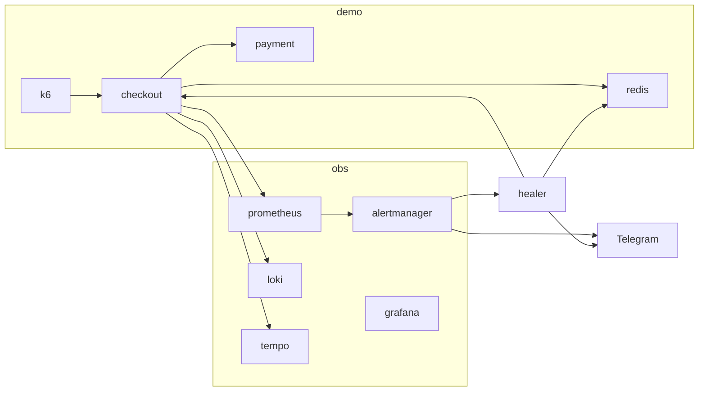

# Кейс 2. SRE-платформа наблюдаемости

Учебный контур вокруг сервиса `checkout` в Kubernetes. Сервис пишет корзину в Redis и вызывает `payment`. Prometheus замечает, что `GET /work` болеет. Healer по уликам решает: чинить самому, спросить человека или не трогать кластер.

Фраза для жюри: система знает, когда лечить нельзя.

## Описание проблемы

Алерт говорит только «checkout болеет». Имя тревоги не говорит, что делать. Рестарт, scale и откат лечат разные поломки, а обрыв сети между живыми сервисами они не лечат вообще. Если автомат всё равно что-то меняет, он тратит время и портит рабочий под.

## Цель работы

Поднять наблюдаемость и замкнутый контур вокруг одного сервиса. Безопасное healer делает сам, после сухого прогона. Опасное показывает в Telegram и ждёт кнопку. Бесполезное не трогает и пишет, почему.

SLO: 99.5% успешных `GET /work`, p95 быстрее 300 мс, доля 5xx ниже 0.5%.

## Состав команды

В `git log` один автор: `spaster`. Отдельного списка ролей и стажа в репозитории нет.

## Архитектура

Один ноутбук. Colima даёт Docker, k3d поднимает кластер `mtc` на одной ноде. Chaos Mesh ломает сеть или под. Healer про эти объекты не знает.



| Namespace | Что внутри |
|---|---|
| `demo` | checkout, payment, Redis, фон k6 |
| `obs` | Prometheus, Alertmanager, Grafana, Loki, Promtail, Tempo |
| `heal` | healer |
| `chaos-mesh` | Chaos Mesh |

## Когда не лечить

Главный пример — обрыв `checkout` → `payment`. Оба пода Ready, Kubernetes их не перезапускает. `GET /work` три секунды ждёт `POST /pay` и отвечает 500 с `payment_timeout`.

Healer видит высокую долю таймаутов и Ready у payment. Удаление пода, scale и откат сеть не открывают: правило Chaos Mesh висит на метках `app=checkout` и `app=payment`, новый под попадает в тот же разрыв. В Telegram уходит «Сам не чиню», кнопок нет, кластер не меняется. Снимает человек: `sh chaos/inject.sh clear`.

Рядом два случая, где healer тоже не лечит сам. Плохой релиз и больной Redis он умеет откатить и перезапустить, но только после Approve: откат меняет выкладку, рестарт Redis стирает корзину в памяти. Если ни одно правило не подошло, он присылает цифры и ничего не меняет.

Короткое убийство пода checkout healer не трогает. У Deployment две реплики, замену поднимает Kubernetes, алерт обычно не копится.

## Инструменты

Версии сняты с этой машины и с работающего кластера `mtc`.

| Инструмент | Версия |
|---|---|
| Colima | 0.10.1 |
| Docker | 29.2.1 |
| k3d | 5.9.0 |
| k3s | v1.35.5+k3s1 |
| kubectl | v1.37.1 |
| Helm | v4.3.0 |
| kube-prometheus-stack | chart 91.5.1 |
| Prometheus | v3.14.0 |
| Alertmanager | v0.34.1 |
| Grafana | 13.2.2 |
| Loki | 3.6.11, chart 7.3.0 |
| Promtail | 3.5.1 |
| Tempo | 2.9.0 |
| Chaos Mesh | 2.8.4 |
| k6 | 0.57.0 |
| Redis | 7-alpine |
| Python | 3.12, FastAPI 0.115.6, OpenTelemetry 1.29.0 |

Ansible ставит только rsyslog и auditd на виртуалку Colima. На этой машине команда `ansible` не стояла в PATH, номер версии не записан. Весь стек одна роль не поднимает.

## Как запустить

`make up` поднимает Colima, кластер `mtc`, образы, сервисы, наблюдаемость, Loki, Chaos Mesh и фон k6. Всплеск k6 в этот подъём не входит. Что именно делает цель, расписано в разделе «Поднять с нуля».

Секрет Telegram в git не входит. Без файла `observability/telegram.local.yaml` и Secret `telegram` в namespace `heal` письма и кнопки не уйдут. Удаление пода и scale при этом работают.

## Мониторинг и наблюдаемость

Два алерта, оба без метки `action`: `CheckoutSlow` и `CheckoutHighErrorRate`. Окно PromQL — 1 минута, `for: 30s`. Дашборды лежат в `observability/dashboards/` и накатываются ConfigMap. На защите открывать **Checkout SLO**.

Связка на одном запросе: точка на графике несёт exemplar с `trace_id`, Tempo открывает спаны, из трейса кнопка ищет ту же строку в Loki. Плохой релиз в трейсе — один красный спан checkout с `reason=fail_rate`, Redis и payment там нет.

Runbook: `docs/runbooks/`. Там смысл алерта, не команда «сделай scale».

## Безопасность

Токен бота и id чата не коммитятся. В `observability/kube-prom-values.yaml` стоят заглушки. Healer читает тот же токен из Secret. Перед удалением пода, scale, откатом и рестартом Redis он делает `dryRun=All`. Права в `demo`: Deployment, ReplicaSet и удаление подов. Публичный адрес для кнопок не нужен: healer сам опрашивает Telegram.

## Использование LLM

В контуре лечения модели нет. Диагноз — правила в `healer/rules.yaml` по метрикам и состоянию подов.

## Troubleshooting

Поломки включаются по одной: `sh chaos/inject.sh`. Две сразу смешают график. Между ними подождать около минуты, пока окно забудет старые точки. Фон k6 не останавливать.

Если healer не откатил плохой релиз: `sh chaos/inject.sh undo-release`. Обрыв сети и задержку снимает `sh chaos/inject.sh clear`. После починки алерт ещё около минуты красный: это лаг окна, не вторая поломка. Когда он гаснет, healer пишет в Telegram, сколько заняла починка и сколько прошло до resolved.

## Лицензия

Отдельный файл лицензии не заведён.

Метка `action` в алерте не нужна. Healer сам собирает улики и идёт по списку ниже. Удаление больного пода и scale делает сам. Откат и рестарт Redis применяет только после кнопки Approve в Telegram. Эскалацию пишет в тот же чат и кластер не трогает.

## Как устроен запрос

`GET /work` — единственная ручка, по которой судят здоровье. Фон k6 постоянно её дёргает, иначе p95 не из чего считать.

1. Если в шаблоне пода задан `EXTRA_LATENCY_MS`, процесс сначала ждёт эти миллисекунды.
2. Если выпал `FAIL_RATE`, ответ сразу 500 с причиной `fail_rate`. В Redis и payment запрос не идёт. Так выглядит плохой релиз: ошибка приложения, не обрыв зависимости.
3. Иначе checkout увеличивает в Redis `cart:seq` и перезаписывает `cart:current`. Это корзина.
4. Вызывает `POST /pay` у payment.
5. Отдаёт 200 и номер корзины либо 500. Причина одна и та же в теле ответа и в JSON-логе: `redis_timeout`, `redis_error`, `payment_timeout`, `payment_error`, `payment_http`.

`/health` всегда 200, чтобы Kubernetes не убил под из-за чужой поломки. `/metrics` отдаёт число запросов, гистограмму времени, `dependency_errors_total{dependency,reason}` и `dependency_duration_seconds`. На счётчик и гистограмму `/work` пишется exemplar: рядом с числом лежит `trace_id` этого запроса.

Таймаут Redis и payment — 3 секунды. Задержка в 2 секунды попадает в график времени. Молчание дольше 3 секунд становится ошибкой зависимости.

`FAIL_RATE` и `EXTRA_LATENCY_MS` стоят в env шаблона Deployment, и у checkout, и у payment. В ConfigMap их нет: `kubectl set env` создаёт новую ревизию, правка ConfigMap — нет. ConfigMap хранит адреса, таймауты и `CPU_ITERS`.

Каждый `/work` крутит `CPU_ITERS` хешей SHA-256, по умолчанию 40000. На этой машине это около 10 мс процессорного времени. Лимит CPU у checkout — `200m`: под может потратить только 0,2 ядра, даже если ноутбук свободен. На замере два пода держат p95 ниже 300 мс примерно до 17 запросов в секунду. На 19 запросах p95 уже около секунды, throttle обоих подов выше 0.5. Пять подов те же 19 запросов отвечают примерно за 0,1 с, throttle ниже 0.2. Сам вызов Redis и payment почти не ест CPU, поэтому без этого цикла всплеск k6 не упёрся бы в лимит.

Redis запущен без снимков на диск (`--save ""`, `--appendonly no`). Корзина живёт в памяти. Рестарт её стирает. Диск `redis-data` примонтирован, но записи туда нет.

## Откуда берётся тревога

Alertmanager логи не читает и метрики не смотрит. Он только принимает уже готовый алерт.

1. Приложение на `/metrics` отдаёт числа.
2. Prometheus раз в 15 секунд забирает их с каждого пода и подписывает ряд именем пода.
3. Правила в `observability/rules.yaml` — запрос PromQL за 1 минуту и таймер `for: 30s`.
4. Условие держится 30 секунд — алерт становится firing, Prometheus отдаёт его в Alertmanager.
5. Alertmanager шлёт всё с меткой `service=checkout` в Telegram и на `http://healer.heal.svc:8080/webhook`.

Два симптома, не две инструкции:

| Алерт | Условие |
|---|---|
| `CheckoutSlow` | p95 `GET /work` за 1 минуту выше 300 мс |
| `CheckoutHighErrorRate` | доля 5xx на `GET /work` за 1 минуту выше 0.5% |

Логи в Loki нужны после тревоги: у строки тот же `trace_id`, что у спана в Tempo. На алерт они не влияют. Это не случайный UUID, а идентификатор трейса OpenTelemetry, 32 шестнадцатеричных символа.

## Как healer разбирает поломку

Chaos Mesh и healer друг о друге не знают. Хаос ломает сеть или под. Healer видит только симптом и улики, как врач: жалоба, анализы, диагноз, одно лечение.

Жалоба — вебхук с firing. Имя алерта говорит лишь «checkout болеет», не «сделай scale».

Анализы healer собирает сам:

- p95 каждого пода checkout;
- упёрся ли под в лимит CPU;
- менялась ли недавно ревизия Deployment;
- причина ошибок: `fail_rate` или обрыв зависимости;
- под Redis в статусе Running;
- поды payment в статусе Ready и есть ли до них таймаут.

Правила проверяются сверху вниз. Сработало первое подходящее — в этот заход остальные не смотрит.

1. Плохой релиз. Ревизия моложе 10 минут, 5xx выше порога, ошибок зависимостей нет. В Telegram план отката и кнопки Approve / Reject. Approve делает dry-run и откатывает checkout.
2. Больной Redis. Checkout не дожидается Redis, под Redis при этом Ready. В тексте цена: корзина в памяти сотрётся, и её текущий номер. Approve перезапускает Deployment `redis`.
3. Нет связи с payment. Доля таймаутов высокая, payment Ready. Сообщение без кнопок. Кластер не меняется.
4. Один медленный под. Его p95 за минуту выше 300 мс и минимум втрое хуже лучшего пода, за последние 30 секунд он всё ещё медленный, CPU не в лимите. Healer сам удаляет этот под после dry-run и пишет в Telegram, что удалил. Если за последние 30 секунд все живые поды уже быстрее 300 мс, повторный вебхук молчит: минутное окно ещё может помнить старые точки.
5. Не хватает квоты. Медленные все поды и throttle у каждого не ниже 0.4. Healer сам ставит 5 реплик. Если 5 уже стоит, а p95 за минуту всё ещё выше 300 мс, это эскалация, а не шестая реплика. Пустой под без throttle эту эскалацию не отменяет. Удаление пода — только когда медленный ровно один, остальные быстрее 300 мс.
6. Ни одно правило не подошло или улики не собрались. Сообщение без кнопок, кластер не меняется.

Пороги этого списка лежат в `healer/rules.yaml`.

| # | Что видит | Поломка | Действие | Кто решает |
|---|---|---|---|---|
| 1 | Ревизия checkout только что сменилась, 5xx со всех подов, причина `fail_rate` | Плохой релиз | Откат на предыдущую ревизию | Кнопка в Telegram. Откат меняет выкладку |
| 2 | Checkout не дожидается Redis, под Redis при этом Running | Redis жив, но болен | Рестарт Redis | Кнопка. В тексте цена: корзина в памяти сотрётся, и её номер |
| 3 | Оба сервиса Ready, в логах таймаут до payment | Нет связи checkout и payment | Ничего не менять, прислать улики | Только человек |
| 4 | Один под в разы медленнее остальных, CPU не упёрт в лимит, ревизия не менялась | Больной экземпляр | Удалить этот под | Сам, после dry-run |
| 5 | Медленные все поды, каждый упёрся в лимит `200m` | Не хватает квоты CPU | Scale до 5, после конца всплеска обратно к 2 | Сам, после dry-run. Выше 5 не поднимается |
| 6 | Ни одно правило не подошло | Неизвестный случай | Ничего не менять, прислать собранные цифры | Только человек |

Короткая смерть пода checkout в таблицу не входит. У Deployment две реплики, Kubernetes сам поднимает замену. Алерт на две минуты обычно не копится, healer молчит. На графике видна короткая яма, бюджет 99.5% почти цел.

Эскалация — сообщение healer в Telegram без кнопок: диагноз и почему кластер не трогали. Повторно в тот же инцидент не шлётся. Alertmanager отдельно пишет, что тревога зажглась или погасла.

Кнопки живут на long polling: healer сам спрашивает Telegram `getUpdates`. Публичный адрес наружу не нужен. Пока ответ не пришёл, новый вебхук второй план не шлёт. Reject и повтор того же диагноза до resolved ничего не меняют. Approve для отката и рестарта Redis тоже сначала делает dry-run.

Перед удалением пода и перед scale сухой прогон такой же: `dryRun=All`, затем настоящий запрос.

Пока идёт одно действие, следующий вебхук по checkout лечение не запускает. Alertmanager зовёт healer повторно раз в минуту, пока тревога горит, и присылает отбой, когда она погасла. В Telegram от Alertmanager это «Checkout тормозит» или «снова быстрее 300 мс», без имени алерта. Delete пода и scale healer пишет сам: «Удалил под …» или «Scale checkout до 5». Когда алерт погас и метрики уже здоровые, healer один раз пишет, сколько заняла починка и сколько прошло до resolved. Часы в этом сообщении стартуют с `startsAt`: момент, когда правило впервые стало истинным. Команду inject healer не видит. Следующие 2 минуты повтор того же firing он только пишет в лог: минутное окно ещё помнит старые точки. Если после этого p95 за минуту всё ещё выше 300 мс, одно сообщение: scale до 5 не снял тормоза, шестую реплику не добавит. Approve и обрыв до payment эту паузу не ждут. Каждый новый вебхук разбирается по свежим цифрам. Два автоматических действия на серию тревог, третье само не делается. Когда тревога погасла и ответы снова быстрые, healer делает scale checkout обратно до 2. Если Job всплеска ещё идёт, он запоминает это и возвращает 2 реплики, когда Job кончился, а GET /work всё ещё быстрее 300 мс. Пороги лежат в `healer/rules.yaml`.

На одной ноде пункт 4 — больной экземпляр, не «ушли с плохой машины». Новый под сядет на ту же ноду и будет здоровым только если задержка была приклеена к старому имени пода. Если Chaos Mesh цепляет и новый под, этот пункт честно становится эскалацией. Scale в пункте 5 помогает, потому что лимит режет квоту пода, а не потому что ноутбук забит. Возврат с 5 реплик на 2 — только когда всплеск нагрузки уже выключен.

## Чем вызывается каждая поломка

Скрипт `chaos/inject.sh` только ломает. Healer про эти команды не знает и видит только симптомы. Кластер сам поднимает только убитый под. На p95 и 5xx он не скейлит: HPA нет.

| Команда | Поломка | Кто это потом чинит |
|---|---|---|
| `sh chaos/inject.sh kill` | Удаляет один под checkout | Kubernetes сам. Healer молчит |
| `sh chaos/inject.sh slow-pod` | 2 с задержки на пакетах одного пода к адресу сервиса payment, 15 минут. Туда и обратно вызов занимает около 4 с и остаётся успешным. Имя пода подставляется в момент запуска, пробы kubelet не задеты | Healer удаляет этот под и пишет в Telegram |
| `sh chaos/inject.sh spike` | Всплеск k6, 6 минут | Healer поднимает реплики до 5 и пишет в Telegram. После конца всплеска возвращает 2 |
| `sh chaos/inject.sh redis` | Ответ этого пода Redis к checkout задерживается на 5 с, 15 минут. Клиент обрывается на своём таймауте 3 с с `redis_timeout`. Пробы kubelet не задеты, под остаётся Ready. Рестарт снимает задержку: правило висит на имени пода | Healer спрашивает рестарт. Approve стирает корзину в памяти |
| `sh chaos/inject.sh bad-release` | `FAIL_RATE=1` в шаблоне Deployment, новая ревизия | Healer спрашивает откат |
| `sh chaos/inject.sh partition` | Сеть между всеми подами checkout и payment режется на 15 минут | Healer ничего не меняет и пишет в Telegram |

`sh chaos/inject.sh clear` снимает NetworkChaos, PodChaos и Job всплеска. Deployment не трогает. Откат плохого релиза отдельно: `sh chaos/inject.sh undo-release`. Это ручной `kubectl rollout undo`, не healer.

На показе команды идут по одной. Две сразу смешают график. Между ними подождать около минуты, пока окно забудет старые точки. Объект Chaos Mesh тот же, что рисует его дашборд. Повторяемый источник — файл и скрипт, не клики.

## Где что лежит

| Путь | Зачем |
|---|---|
| `apps/checkout` | Мишень. `/health`, `/work`, `/metrics`. |
| `apps/payment` | `POST /pay`, свои `/health` и `/metrics`. |
| `healer` | Вебхук, диагноз, dry-run, удаление пода, scale, кнопки Telegram на откат и рестарт Redis. |
| `healer/rules.yaml` | Пороги диагноза: окно ревизии, доля ошибок, во сколько раз один под медленнее, throttle, потолок 5 реплик. |
| `k8s/` | Namespace `demo`, Redis, payment, checkout, ServiceMonitor, healer и его RBAC. |
| `observability/rules.yaml` | `CheckoutHighErrorRate` и `CheckoutSlow`. Без метки `action`. |
| `observability/dashboards/` | Четыре дашборда Grafana. SLO считает 99.5% и p95. |
| `observability/kube-prom-values.yaml` | Helm-значения Prometheus, Grafana и Alertmanager. Без секрета. |
| `observability/telegram.local.yaml` | Токен бота и id чата. В git не входит. |
| `k8s/tempo.yaml` | Tempo в `obs`. Принимает трейсы по OTLP HTTP `:4318`, отдаёт их Grafana на `:3200`. Диск пустой, хранение сутки. |
| `observability/tempo-datasource.yaml` | Источник Tempo в Grafana и переход трейс → логи. |
| `observability/loki-values.yaml` | Loki в `obs`, один инстанс. |
| `observability/promtail-values.yaml` | Promtail в кластере: stdout подов. |
| `observability/promtail-host.yaml` | Promtail на виртуалке Colima: syslog и audit.log. |
| `ansible/` | Роль `node-logs`: rsyslog и auditd на Colima. Весь кластер она не ставит. |
| `docs/runbooks/` | Что означает каждый алерт. Лечение там больше не прописано как метка `action`. |
| `k6/background.js` | Фон: 3 запроса/с на `/work`, сутки. |
| `k6/spike.js` | Всплеск: 16 запросов/с, 6 минут, каждое соединение новое. Вместе с фоном 3 это около 19: два пода упираются в CPU, пять отвечают примерно за 0,1 с. Старые соединения после scale не держат трафик на прежних подах. |
| `k8s/k6-background.yaml` | Deployment фона в `demo`. |
| `k8s/k6-spike.yaml` | Job всплеска. Повторный запуск — удалить Job и применить снова. |
| `chaos/inject.sh` | Включает одну поломку. Healer не вызывает. |
| `chaos/checkout-kill.yaml` | PodChaos, один под checkout. |
| `chaos/checkout-slow-pod.yaml` | Задержка на имя пода. В файле плейсхолдер `POD_NAME`. |
| `chaos/redis-slow.yaml` | Задержка на имя пода Redis, только трафик от checkout. |
| `chaos/partition-payment.yaml` | Разрыв checkout и payment по меткам. |

## Как это крутится

Один ноутбук. Colima даёт Docker, k3d внутри Docker поднимает кластер `mtc` на одной ноде.

| Namespace | Что внутри |
|---|---|
| `demo` | Два пода checkout, один payment, один Redis, фон k6. |
| `obs` | Prometheus, Grafana, Alertmanager, Loki, Promtail, Tempo. |
| `heal` | Healer. |
| `chaos-mesh` | Chaos Mesh. |

Права healer в `demo`: Deployment, ReplicaSet, и удаление подов. Рестарт Redis — это patch Deployment `redis`, он тем же правом уже разрешён, но код его не вызывает, пока нет подтверждения.

Журналы виртуалки Colima (`/var/log/syslog`, `/var/log/audit/audit.log`) ставит Ansible. Их читает отдельный Promtail на этой виртуалке. Нода k3d — контейнер, своих rsyslog и auditd у неё нет.

Лог приложения — одна JSON-строка в stdout с `trace_id` и `reason`. `trace_id` берётся из текущего спана. Checkout начинает трейс на `GET /work`, внутри него спаны Redis и `POST /pay`. Payment продолжает тот же трейс по заголовку `traceparent`. В Grafana источник Loki, запрос `{namespace="demo", app="checkout"} | json | trace_id="..."`. Из лога поле TraceID открывает Tempo, из трейса кнопка ведёт обратно в логи.

## Поднять с нуля

```bash
make up
```

Ниже те же шаги по отдельности. `brew install kubectl k3d helm` make не ставит.

```bash
brew install kubectl k3d helm
colima start --cpu 4 --memory 8 --disk 40
docker context use colima
k3d cluster create mtc --agents 0
```

Образы и сервисы:

```bash
docker build -t checkout:dev apps/checkout
docker build -t payment:dev apps/payment
docker build -t healer:dev healer
k3d image import checkout:dev payment:dev healer:dev -c mtc
kubectl apply -f k8s/namespace.yaml -f k8s/redis.yaml -f k8s/payment.yaml -f k8s/checkout.yaml
kubectl create configmap k6-scripts -n demo \
  --from-file=k6/ \
  --dry-run=client -o yaml | kubectl apply -f -
kubectl apply -f k8s/k6-background.yaml
```

Наблюдаемость. Файл с токеном должен уже лежать локально, в репозитории его нет.

```bash
helm repo add prometheus-community https://prometheus-community.github.io/helm-charts
helm repo update
helm upgrade --install kube-prom prometheus-community/kube-prometheus-stack \
  -n obs --create-namespace \
  -f observability/kube-prom-values.yaml \
  -f observability/telegram.local.yaml
kubectl apply -f k8s/checkout-servicemonitor.yaml -f observability/rules.yaml -f k8s/healer.yaml
kubectl apply -f k8s/tempo.yaml -f observability/tempo-datasource.yaml -f observability/loki-datasource.yaml
```

Дашборды:

```bash
kubectl create configmap mtc-dashboards -n obs \
  --from-file=observability/dashboards/ \
  --dry-run=client -o yaml | kubectl apply -f -
kubectl label configmap mtc-dashboards -n obs grafana_dashboard=1 --overwrite
```

Grafana: `kubectl port-forward -n obs svc/kube-prom-grafana 3000:80`, логин `admin` / `admin`. В поиске: **Checkout SLO**, **Checkout RED**, **Обзор сервисов**, **Инцидент**. На защите открывать **Checkout SLO**.

Логи:

```bash
helm repo add grafana https://grafana.github.io/helm-charts
helm upgrade --install loki grafana/loki -n obs -f observability/loki-values.yaml
helm upgrade --install promtail grafana/promtail -n obs -f observability/promtail-values.yaml
kubectl apply -f k8s/loki-nodeport.yaml -f observability/loki-datasource.yaml
sh ansible/colima-inventory.sh
cd ansible && ansible-playbook playbooks/node-logs.yaml && cd ..
docker run -d --name promtail-host --restart unless-stopped --user 0 \
  --network container:k3d-mtc-server-0 \
  -v /var/log:/var/log:ro \
  -v "$PWD/observability/promtail-host.yaml":/etc/promtail/config.yml:ro \
  grafana/promtail:3.5.1 -config.file=/etc/promtail/config.yml
```

Chaos Mesh:

```bash
helm repo add chaos-mesh https://charts.chaos-mesh.org
helm upgrade --install chaos-mesh chaos-mesh/chaos-mesh -n chaos-mesh --create-namespace \
  --set chaosDaemon.runtime=containerd \
  --set chaosDaemon.socketPath=/run/k3s/containerd/containerd.sock \
  --set dashboard.securityMode=false
```

Проверка ручки, без хаоса:

```bash
kubectl port-forward -n demo svc/checkout 8080:80
curl -s http://127.0.0.1:8080/work
```

В ответе `status`, `cart_seq`, `payment`, `trace_id`.

Фон и всплеск. Скрипты лежат в ConfigMap, поды k6 ходят на `http://checkout/work` внутри кластера.

```bash
kubectl create configmap k6-scripts -n demo \
  --from-file=k6/ \
  --dry-run=client -o yaml | kubectl apply -f -
kubectl apply -f k8s/k6-background.yaml
```

Всплеск не входит в обычный подъём. Его включают отдельно и не гасят руками: Job сам кончается через 6 минут. Пока идёт всплеск, фон не останавливать. Когда алерт погаснет, healer сам вернёт checkout к 2 репликам.

```bash
kubectl delete job k6-spike -n demo --ignore-not-found
kubectl apply -f k8s/k6-spike.yaml
kubectl logs -n demo job/k6-spike -f
```

На дашборде **Инцидент** график «p95 /work по подам» и «Доля CPU throttle по подам». Во время всплеска на двух репликах throttle поднимается у обоих подов, p95 уходит выше 300 мс. Если поднять checkout до 5 реплик в эти же шесть минут, квоты хватает и p95 должен вернуться. Один больной под выглядит иначе: тормозит одна линия, throttle у остальных около нуля.

С ноутбука, без пода k6:

```bash
kubectl port-forward -n demo svc/checkout 8080:80
k6 run -e BASE_URL=http://127.0.0.1:8080/work k6/background.js
```

## Секреты

`observability/telegram.local.yaml` в `.gitignore`. В `kube-prom-values.yaml` стоят заглушки `PASTE_BOT_TOKEN` и `chat_id: 0`. Не коммить файл с настоящим токеном. Скопируй блок `receivers` из `kube-prom-values.yaml` в `telegram.local.yaml` и подставь токен и id чата. Это письмо Alertmanager.

Healer для кнопок читает тот же токен из Secret, не из git. Без Secret он по-прежнему удаляет под и делает scale, а откат и рестарт только пишет в лог `needs approval`.

```bash
kubectl create secret generic telegram -n heal \
  --from-literal=token=BOT_TOKEN \
  --from-literal=chat_id=CHAT_ID
kubectl rollout restart deployment/healer -n heal
```

## Трейс

Один запрос `GET /work` — один трейс. Внутри три шага, если запрос дошёл до зависимостей: сам `/work`, Redis, `POST /pay` у payment. Плохой релиз (`FAIL_RATE=1`) обрывается раньше: в трейсе только красный спан checkout с `reason=fail_rate`, Redis и payment там нет. Так видно, что ошибка внутри новой версии, а не в сети.

Tempo стоит в `obs`. Приложения шлют спаны на `http://tempo.obs.svc.cluster.local:4318`. Prometheus забирает `/metrics` в формате OpenMetrics и хранит до 100000 exemplars в памяти. На дашборде **Инцидент** график «Запросы и пример трейса»: клик по точке открывает этот запрос. В Tempo кнопка логов ищет в Loki ту же строку. В логе поле TraceID открывает трейс обратно.

`/health` и `/metrics` в Tempo не пишутся, иначе пробы забьют хранилище.

## Замер MTTR

MTTR здесь — от начала поломки до починки. Второе число — до resolved: алерт ещё горит, пока окно `[1m]` помнит старые точки, плюс `for: 30s`. Часы в UTC. «Погас» — следующий пустой шаг ряда Prometheus после последней firing-точки, шаг 15 секунд.

Где известна команда inject, старт — она. У медленного пода и всплеска секунда inject не сохранилась, там старт — firing.

| Поломка | До починки | До resolved | После починки алерт ещё горел |
|---|---|---|---|
| Один медленный под, 4 октября | 5 с от firing. Delete в 17:08:20, firing с 17:08:15 | 5 мин, погас после 17:13:00 | около 5 мин. p95 оставался выше 300 мс дольше, чем одно минутное окно. В 17:15 тревога зажглась снова, в 17:17 healer удалил ещё один под |
| Один медленный под, 5 октября | 1 мин 34 с от inject в 10:50:30. Delete в 10:52:04 | 3 мин 34 с, сообщение в 10:54:04 | В Telegram часы от `startsAt`, не от команды: до починки 23 с, до resolved 2 мин 22 с, после починки ещё 2 мин |
| Всплеск k6, 5 октября | 25 с от firing. Scale до 5 в 00:26:40, firing с 00:26:15 | 1 мин 30 с, погас после 00:27:30 | 1 мин 5 с. Реплики вернулись к 2 в 00:31:54, когда Job кончился. Это уже после resolved |
| Больной Redis, 5 октября | 2 мин 39 с от inject в 10:12:54. Рестарт в 10:15:33. Внутри — ожидание Approve с 10:14:03 | 3 мин 51 с, погас после 10:16:30 | 1 мин 12 с |
| Плохой релиз, 5 октября | 2 мин 32 с от inject в 10:25:28. Откат в 10:28:00. Просьба Approve была в 10:27:03 | 3 мин 47 с, погас после 10:29:00 | 1 мин 15 с |
| Обрыв checkout → payment, 5 октября | около 1 мин 30 с от inject в 10:30:51. Healer не чинил, `clear` около 10:32:20 | около 2 мин 54 с, погас после 10:33:30 | около 1 мин 25 с |

Короткое убийство пода checkout в таблицу не входит. Kubernetes поднимает замену сам, алерт на две минуты обычно не копится, пары чисел нет.

## Проверка на push

На push и pull request GitHub Actions гоняет тесты и собирает образы checkout, payment и healer. Кластер, Helm-чарты и чужие образы CI не трогает. В registry ничего не пушится.
