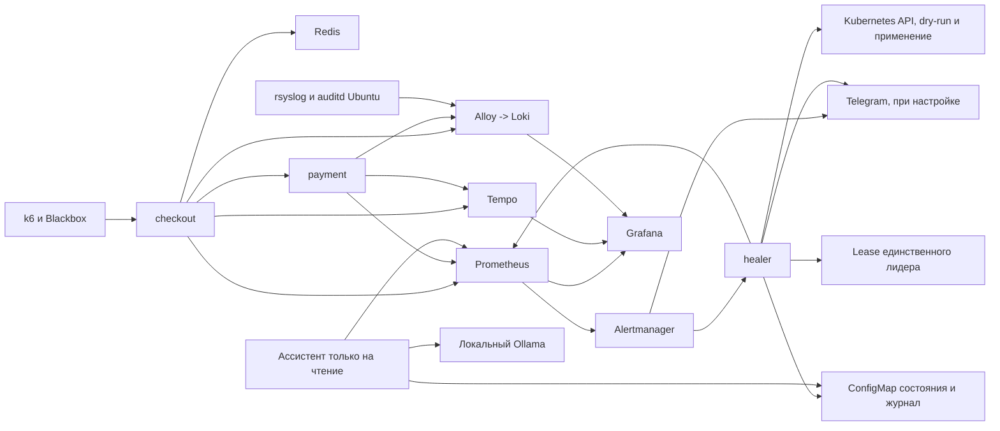

# Кейс 2. SRE-платформа наблюдаемости

Проблема кейса - обнаружить деградацию пользовательского запроса, связать метрики с трейсом и журналом и восстановить SLO с проверяемыми ограничениями вмешательства. Цель - воспроизводимый контур Kubernetes, в котором сбой обнаруживается по запросам, безопасное восстановление выполняется после dry-run, опасное действие требует актуального подтверждения, а MTTR заканчивается после восстановления SLO.

Каждое требование кейса связано с реализацией, проверкой и ограничениями в [docs/requirements.md](docs/requirements.md). Назначение LLM - анализ текущей ситуации и черновик отчета об инциденте по журналу действий.

В рабочей ветке `fix/sre-case-completion` завершена последняя итерация: [полный Ubuntu CI dae8ac7](https://github.com/spasster/MTC-SRE/actions/runs/37615665833) прошел, [459 тестов Linux CI](docs/results/iteration-6/unit-current/run.json) успешны, результаты и [итоговый аудит](docs/audit.md) сохранены. Дополнительно 428 тестов healer прошли на Windows. В контрольной паре медленного пода MTTR 135.0 -> 121.8 с; CPU-профиль 11 RPS текущего CI восстановил SLO за 147.8 с во время нагрузки и вернул масштаб самостоятельно. [Видео 4:12](docs/demo.md), NoData, браузерная связка и postmortem проверены отдельно в собственном контуре. Новые самостоятельные итерации отключены.

`checkout` записывает корзину в Redis и вызывает две реплики `payment`. Istio обеспечивает резервный путь при отказе установления соединения. Фоновый k6 создаёт 3 запроса в секунду. Правила healer различают медленный под, нехватку CPU, ошибку релиза и отказ зависимости. Диагноз строится по данным, без LLM.

## SLO и подтверждение восстановления

| Показатель GET /work | Цель | Проверка |
|---|---|---|
| Успешные запросы | Не менее 99.5% | Доля 5xx за 1 минуту не выше 0.5% |
| Задержка | p95 ниже 300 мс | Гистограмма длительности за 1 минуту |
| Рабочая цепочка | Доступна | Blackbox: HTTP 200, status=ok, payment=ok |

Это короткие окна для восстановления. Отдельно рассчитывается бюджет SLO за 30 дней, покрытие истории и расход по двум окнам; [методика и ограничения](docs/runbooks/slo-budget.md). История стенда короче месяца, поэтому месячное соблюдение SLO не заявляется. Для закрытия инцидента дополнительно нужны свежая успешная синтетика, ненулевой поток запросов и готовность текущей ревизии Deployment. Пустые ряды, NaN и устаревшая синтетика не означают здоровье.

## Архитектура



| Namespace | Компоненты |
|---|---|
| demo | checkout, payment, Redis, k6; STRICT mTLS Istio |
| obs | Prometheus, Alertmanager, Grafana, Blackbox, Loki, Alloy, Tempo |
| heal | healer и необязательный SRE-ассистент |
| istio-system | Istiod |
| chaos-mesh | Chaos Mesh |
| assist | Необязательный Ollama |

Метрики обслуживаются отдельным HTTP-портом 8081. Рабочие порты checkout, payment и Redis требуют mTLS. Проверка доступа описана в [docs/mtls.md](docs/mtls.md). Alloy собирает JSON-логи приложений; Ansible настраивает системные журналы Ubuntu: [docs/linux-logs.md](docs/linux-logs.md).

## Запуск на Ubuntu

Нужны Docker Engine с доступом текущего пользователя, make, kubectl, Helm 3.17.4, k3d 5.9.0, Python 3.12 и ansible-core 2.18.12. Роль журналов требует sudo и ядро с audit. Рекомендуемый запас для учебного стека - 4 CPU, 8 ГБ RAM и 40 ГБ диска; для LLM дополнительно 4 ГБ RAM и место для образа и модели. Это ориентир, не результат испытания минимальных ресурсов.

```sh
sudo apt-get update
sudo apt-get install -y make python3-venv rsyslog auditd
python3 -m venv .venv
. .venv/bin/activate
pip install ansible-core==2.18.12
cd ansible
ansible-playbook -i localhost, playbooks/stack.yaml
```

Docker, kubectl, Helm и k3d устанавливаются отдельно из официальных дистрибутивов. Роль `sre-stack` устанавливает весь контур через `make up-linux`, роль `node-logs` настраивает rsyslog и auditd. Порядок полной чистой установки и версии CLI также записаны в [.github/workflows/e2e.yml](.github/workflows/e2e.yml). На macOS с Colima используется `make up`.

Для другого имени кластера передать `CLUSTER=имя` в make и экспортировать ту же переменную для скриптов. Мутации проверяют контекст `k3d-$CLUSTER`. Сборка идёт последовательно: образы, Istio, приложения, CRD мониторинга, ServiceMonitor, дашборды, журналы, Chaos Mesh и готовность стека. `make -j` этот порядок не меняет. Образы импортируются непосредственно в k3d, включая окружение с отдельным DOCKER_HOST.

```sh
kubectl port-forward -n obs svc/kube-prom-grafana 3000:80
kubectl port-forward -n obs svc/kube-prom-kube-prometheus-prometheus 19090:9090
kubectl port-forward -n obs svc/tempo 13200:3200
kubectl port-forward -n obs svc/loki 13100:3100
```

Каждая команда занимает отдельный терминал. Открыть Grafana на http://localhost:3000, дашборд «SLO checkout». Пароль admin создаётся случайно в Secret `grafana-admin`, ключ `password`; получать его локально, не добавлять в Git, видео и отчёты. Стандартного пароля в values нет.

## Решения healer

Сбор метрик ограничен namespace `demo` и подами текущей ревизии Deployment checkout; обе управляющие связи требуют UID и controller=true. Перед диагностикой проверяются успешный scrape, возраст данных не более 45 секунд к окончанию сбора и полнота серий каждого рабочего пода. Сбор допускается в общий бюджет 20 секунд, запросы SDK имеют отдельный таймаут 5 секунд; поздний ответ запрещен. Нулевые счетчики ошибок экспортируются явно; отсутствие серии запрещает вмешательство и подтверждение восстановления. Синтетика имеет отдельную метку `target_namespace`, поэтому данные второго checkout не смешиваются с этим контуром.

| Наблюдаемая причина | Действие | Условие |
|---|---|---|
| Один под минимум втрое медленнее остальных | Удалить этот под | Актуальный p95, низкий CPU throttle, dry-run |
| Все поды ограничены CPU | Масштабировать до 5 | Нет ошибок зависимостей, лимит действий и общее окно ожидания |
| Свежий релиз и ошибки приложения | Откатить ревизию | Подтверждение Telegram; повторная проверка ревизии и диагноза |
| Redis Ready, но запросы к нему не проходят | Перезапустить Redis | Подтверждение: корзина хранится в памяти и будет потеряна |
| payment Ready, но вызовы завершаются таймаутом | Передать человеку | Перезапуск checkout не открывает сеть |
| Ошибки payment, неизвестная причина или нет метрик | Передать человеку | Изменений кластера нет |

Разрешено максимум два действия за инцидент, окно ожидания между действиями - 120 секунд. Автоматически уменьшается только масштабирование, выполненное самим healer. Изменённое оператором число реплик не уменьшается по чужому resolved. Неудачное уменьшение повторяется позже.

Подтверждение привязано к случайному ID, чату, ревизии и сроку 5 минут. Старые кнопки, изменение Deployment и изменившийся диагноз отменяют применение. Ошибка или пропуск Kubernetes не объявляются восстановлением. Проверка здоровья работает каждые 5 секунд независимо от Telegram.

Состояние, таймеры, лимит действий и журнал сохраняются в ConfigMap `heal/healer-state`. Lease `heal/healer-leader` допускает одного владельца записи среди нескольких экземпляров. Намерение команды записывается до Kubernetes API; неизвестный результат запрещает повторное применение до проверки. Ожидающее подтверждение после замены лидера отменяется. Реальная проверка замены пода и двух экземпляров: [healer-state.json](docs/results/iteration-1/healer-state.json).

Дашборд «Healer» показывает лидера, доступность состояния, свежесть снимка, решения и операции. Алерты потери данных, зависшего цикла и неопределенного результата описаны в [runbook healer](docs/runbooks/healer.md).

## Telegram и секреты

Без Telegram автоматическое удаление медленного пода и scale работают; опасные действия остаются неприменёнными. Для Telegram нужны TELEGRAM_BOT_TOKEN, TELEGRAM_CHAT_ID и TELEGRAM_ALLOWED_USER_IDS. Токен можно ввести скрыто через `python scripts/configure-telegram.py --cluster mtc`, затем повторить `make observability`. `scripts/configure-secrets.sh` сохраняет имеющиеся настройки Secret и создает игнорируемый файл `.runtime/notification-values.yaml`, не выводя значения. Вебхук Alertmanager и `/status` требуют общий Bearer-токен Secret `healer-webhook`.

Создан отдельный тестовый бот. В его личном чате проверены реальный подтвержденный откат и отказ от рестарта Redis: [telegram-approve.json](docs/results/iteration-1/telegram-approve.json), [telegram-reject.json](docs/results/iteration-1/telegram-reject.json). Существующие группы не изменялись. Список операторов, срок кнопок и журнал подтверждений описаны в [docs/telegram.md](docs/telegram.md).

## Алерты и runbook

Правила вычисляются каждые 15 секунд. Ошибки и задержка используют окно 1 минута и `for: 30s`; синтетическая недоступность - `for: 30s`. Дашборд SLO показывает более сглаженное окно 5 минут. Отсутствие синтетики 2 минуты вызывает отдельную критическую тревогу после ещё 1 минуты. Alertmanager группирует по service и alertname, отправляет на healer и при настройке в Telegram. Повтор healer - 1 минута, Telegram - 30 минут.

- [CheckoutSlow](docs/runbooks/checkout-slow.md)
- [CheckoutHighErrorRate](docs/runbooks/checkout-high-error-rate.md)
- [Синтетическая проверка](docs/runbooks/checkout-synthetic.md)

Точка exemplar на графике Prometheus содержит trace_id; Tempo показывает checkout и payment, Loki находит логи обоих по тому же ID. Скрипт `scripts/verify-observability.py` проверяет этот переход по настоящим данным, результат - [docs/results/observability.json](docs/results/observability.json).

## Хаос, нагрузка и MTTR

```sh
sh chaos/inject.sh slow-pod
sh chaos/inject.sh spike
sh chaos/inject.sh kill
sh chaos/inject.sh partition
sh chaos/inject.sh redis
sh chaos/inject.sh bad-release
sh chaos/inject.sh undo-release
sh chaos/inject.sh clear
```

Включать по одному сценарию. Задержка 250 мс выбирает один checkout и его исходящие пакеты к Redis, сохраняя ответы зависимостей. Сетевой разрыв checkout -> payment проверяется отдельно; его connectTimeout 100 мс не меняется для сценария задержки. Короткое убийство пода восстанавливает Deployment. При обрыве сети автоматического изменения нет; оператор снимает правило. После `clear` дождаться здорового SLO, исчезновения всех активных алертов и закрытого инцидента healer.

Сравнение одинакового сценария:

```sh
python scripts/experiment.py --mode baseline --output docs/results/slow-pod-baseline.json
python scripts/experiment.py --mode auto --output docs/results/slow-pod-auto.json
python scripts/capacity.py --rates 3,9,12,15,16,18,24 --duration 120 --continue-after-failure --refine-cpu-profile --output .runtime/cpu-capacity.json
python scripts/experiment.py --scenario spike --mode auto --natural-end --spike-capacity .runtime/cpu-capacity.json --timeout 660 --output .runtime/spike-lifecycle.json
python scripts/benchmark.py --pairs 5 --output-dir docs/results/repeated-mttr
python scripts/capacity.py --duration 120 --output docs/results/capacity-stages.json
```

Baseline отключает healer и задаёт задержку оператора 30 секунд после firing. Это контролируемая модель, не замер скорости человека. Скрипт сохраняет метрики, момент внесения сбоя, детект, принятие команды API и три последовательных здоровых измерения. MTTR отсчитывается от внесения сбоя до этих измерений. Встроенный таймер healer начинается с startsAt алерта, поэтому его значение отличается от внешнего таймера эксперимента.

Профиль полного CPU-демо выбирается по свежим парным замерам текущего контура и версии. При необходимости измеряются до трех промежуточных RPS; пропуски клиента запрещают выбор. После серии подтверждаются исходные Deployment, SLO и закрытый инцидент. В CPU-опыте фон временно выключен, весь выбранный поток создает собственный Job. Итог требует нарушения SLO, принятого scale, восстановления во время продолжающейся нагрузки и самостоятельного возврата к двум репликам. [Методика и история отказов](docs/cpu-profile.md) сохраняют прежние образы и профили; их RPS не переносятся в новый контур автоматически.

Результаты и ограничения сравнения находятся в [docs/experiments.md](docs/experiments.md). Старые цифры 4-5 октября измеряли в основном принятие команды и не используются как доказательство MTTR. Во время сравнения LLM выключен.

## Локальный LLM

`make llm` запускает Ollama 0.35.1 и Qwen2.5 1.5B на CPU. `/report` объясняет текущий снимок, `/postmortem` готовит черновик отчета по последнему инциденту. Ассистент имеет отдельный ServiceAccount с чтением разрешенных объектов и ConfigMap журнала, ограниченный промпт и API отчета без применения действий. MTTR и временная шкала вычисляются кодом и возвращаются отдельно от текста модели. Настройка, ресурсы, промпты и ограничения: [docs/llm.md](docs/llm.md).

## Версии, проверки и материалы

Версии инфраструктуры закреплены в [versions.mk](versions.mk): k3s 1.35.5-k3s1, kube-prometheus-stack 91.9.0, Loki chart 7.3.0, Alloy chart 1.13.0 / образ 1.20.0, Istio 1.30.5, Blackbox chart 11.19.1 / образ 0.28.0, Chaos Mesh 2.8.4. Tempo 2.9.0, k6 0.57.0, Redis 7-alpine. Python base закреплён digest; зависимости сервисов закреплены в requirements.txt.

На push проверяются тесты трех сервисов и сборка образов. Полный CI запускается для изменений кода и инфраструктуры во всех ветках и pull request. Он устанавливает стек через Ansible на чистом Ubuntu и проверяет mTLS, журналы, связку наблюдаемости одного инцидента, правила Prometheus, права healer, удержание SLO в заданном профиле ограниченного хаоса, отказы зависимостей, сохранение состояния, baseline/auto, мощность и самостоятельный возврат масштаба. CPU-профиль выбирается по завершенным замерам того же контура и версии, а восстановление должно произойти во время нагрузки. Ограничение выполнения - 120 минут с учетом ограниченного уточнения сетки мощности. Результаты аудита: [docs/audit.md](docs/audit.md). Общий план и назначение LLM: [docs/plan.md](docs/plan.md). История выполненных итераций: [docs/iteration-2.md](docs/iteration-2.md), [docs/iteration-3.md](docs/iteration-3.md), [docs/iteration-4.md](docs/iteration-4.md) и [docs/iteration-5.md](docs/iteration-5.md). Заключительный этап последней итерации: [docs/iteration-6.md](docs/iteration-6.md). Описание исправлений: [docs/changes.md](docs/changes.md). Материалы демонстрации: [docs/demo.md](docs/demo.md).

## Команда и ограничения

Состав и распределение ответственности согласованы владельцем проекта. Подробная матрица задач, результатов и проверок находится в [docs/team.md](docs/team.md). Опыт участников будет дополнен после получения сведений; по авторству коммитов он не выводится. Отдельная лицензия в исходном репозитории отсутствует.

| Участник | Роль | Область ответственности |
|---|---|---|
| Нелин Данила | Технический руководитель | Архитектура, SLO, границы автоматического вмешательства, техническое ревью и приемка |
| Захаров Максим | Инженер сервисов и наблюдаемости | Checkout/payment, метрики, журналы, трассировка и связь данных в Grafana |
| Шестаков Данила | Инженер испытаний надежности | Chaos Mesh, k6, методика и повторяемость экспериментов, MTTR и мощность |
| Митрюшкина Жанна | Ведущий DevOps/SRE-инженер, владелец инфраструктуры и контура автоматического восстановления | Kubernetes, CI/CD, mTLS и RBAC, сборка платформы наблюдаемости, надежность и безопасность healer, аудит готовности |

При сбое запуска сначала проверить Docker, текущий контекст, Ready подов, события и доступ к registry. Загрузка образов и Helm-чартов требует сети; Healthy под не заменяет проверку запроса, трейсинга и доставки журналов. WSL использован для локального стенда; полноценный auditd проверяется на Ubuntu с поддержкой audit.
