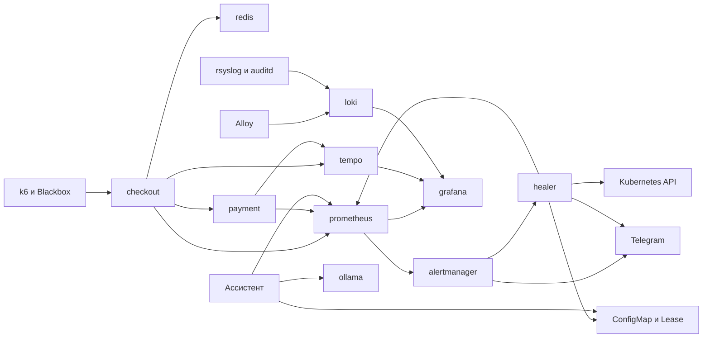

# Архитектура и стек. Кейс 2, SRE-платформа наблюдаемости

Учебный сервис `checkout` принимает `GET /work`, пишет корзину в Redis и вызывает `payment`. Платформа замечает, что запросы стали медленными или ошибочными, связывает метрику, трейс и лог одного запроса и восстанавливает сервис с проверяемыми ограничениями.

Диагноз и лечение выполняет `healer` по правилам и цифрам. Локальная языковая модель кластер не меняет: она объясняет текущие цифры или готовит черновик отчёта по уже закрытому инциденту.

Запуск и версии: [README](../README.md).

## Как идёт один запрос

1. Фон k6 непрерывно вызывает `GET /work` у checkout, около 3 запросов в секунду. Отдельный всплеск нагрузки запускается как Kubernetes Job `k6-spike`.
2. Checkout увеличивает номер корзины в Redis и вызывает `POST /pay` у payment.
3. Checkout и payment пишут JSON-лог в stdout и отправляют трейс в Tempo. У запроса один `trace_id` на оба сервиса.
4. Метрики приложений отдаются на отдельном порту 8081. Рабочие порты checkout, payment и Redis закрыты mTLS: сервисы принимают соединения только друг от друга.
5. Blackbox Exporter сам периодически вызывает рабочую цепочку и записывает, ответила ли она успешно. Это проверка «сайт жив сейчас», отдельно от статистики уже прошедших запросов.



Alloy читает stdout подов. Журналы самой машины Ubuntu в Loki попадают отдельно: [ниже](#системные-журналы-ubuntu).

## Как компоненты общаются

Отдельной базы приложения нет. Записи Kubernetes лежат в etcd кластера. Программы ходят друг к другу по HTTP и по API Kubernetes.

| Кто | Куда | Зачем |
|---|---|---|
| Prometheus | порт 8081 приложений и healer | забирает метрики каждые 15 секунд |
| Blackbox | `GET /work` | пробный заход пользователя |
| Alertmanager | `POST` на webhook healer | готовая тревога, не сырые метрики |
| healer | Prometheus | свежие цифры перед решением |
| healer | Kubernetes API | dry-run, затем удаление пода, scale, откат или рестарт Redis |
| healer | Telegram | вопрос с кнопкой и опрос ответа |
| Grafana | Prometheus, Loki, Tempo | экраны, без записи состояния |
| ассистент | Prometheus, ConfigMap, Ollama | текст отчёта, без команд в кластер |

## Как обнаруживается и лечится поломка

1. Правило Prometheus смотрит последнюю минуту. Если доля ошибок `GET /work` выше 0,5% или p95 медленнее 300 мс и это держится 30 секунд, появляется тревога.
2. Alertmanager отправляет её healer. При настроенном Telegram то же уведомление уходит в чат.
3. Healer собирает один снимок: ошибки, задержка по подам, загрузка CPU, результат Blackbox, текущие поды checkout. Снимок принимается, только если цифры из namespace `demo`, поды принадлежат текущей версии checkout и точки свежие.
4. Правила в `healer/rules.yaml` выбирают одно действие. Безопасное healer выполняет сам после dry-run: Kubernetes сначала проверяет команду, не применяя её. Опасное уходит в Telegram и выполняется после кнопки разрешённого оператора. Как устроена кнопка: [ниже](#выделенный-бот-и-права-операторов).
5. Каждые 5 секунд healer проверяет, вернулись ли хорошие цифры. Инцидент закрывается, когда запросы снова успешные и быстрые, пробный заход Blackbox свежий и успешный, а нужная версия Deployment поднята. Время от внесения поломки до этого момента — MTTR. Момент «Kubernetes принял команду» финишем не считается.

| Что видно по цифрам | Действие | Кто решает |
|---|---|---|
| Один под минимум втрое медленнее остальных, CPU при этом не упёрт в лимит | Удалить этот под | Healer сам, после dry-run |
| Все поды медленные и упёрлись в лимит CPU | Поднять checkout с 2 до 5 реплик | Healer сам, после dry-run |
| Свежий релиз и ошибки самого приложения | Откатить checkout | Кнопка в Telegram |
| Redis жив, но checkout до него не достучался | Перезапустить Redis | Кнопка в Telegram: корзина хранится в памяти и сотрётся |
| Payment жив, но вызовы до него обрываются по таймауту | Ничего не менять | Только человек: перезапуск сеть не откроет |
| Нет метрик, неизвестная причина или ошибка самого payment | Ничего не менять | Только человек |

За один инцидент разрешено не больше двух изменений кластера. После действия пауза 120 секунд. Кнопка Telegram действует 5 минут и только для того запроса, к которому её отправили. Вернуть checkout с 5 реплик на 2 healer может только если пятёрку поставил он сам и всплеск k6 уже закончился.

Пустые или устаревшие метрики не считаются здоровьем. Пока цифр нет, healer не закрывает инцидент и не уменьшает число реплик.

Что смотреть дежурному: [CheckoutSlow](runbooks/checkout-slow.md), [CheckoutHighErrorRate](runbooks/checkout-high-error-rate.md), [синтетика](runbooks/checkout-synthetic.md), [связка метрика-трейс-лог](runbooks/incident-chain.md), [бюджет SLO](runbooks/slo-budget.md), [отказ самого healer](runbooks/healer.md).

## Где что хранится

| Что | Где | Кто пишет и кто читает |
|---|---|---|
| Текущий инцидент, журнал команд и событий | Один ConfigMap `heal/healer-state`, поле `state.json` | Пишет и читает healer. Ассистент только читает |
| Право лечить, одна активная копия healer | Lease `heal/healer-leader` | Берёт и обновляет healer |
| Число реплик и версии сервисов | Deployment в Kubernetes | Меняет healer в пределах своих прав |
| Корзина | Память Redis, без записи на диск | Пишет checkout |
| Метрики | Диск Prometheus | Пишут приложения и Blackbox, читают Prometheus, healer, Grafana, ассистент |
| Логи подов и журналы Ubuntu | Loki | Собирает Alloy, читает Grafana |
| Трейсы | Tempo | Пишут checkout и payment, читает Grafana |
| Секреты Telegram, webhook и пароль Grafana | Secret Kubernetes | В git не попадают |
| Ответ языковой модели | Только HTTP-ответ запросившему | В ConfigMap и в Loki не сохраняется |
| Файлы модели | Диск тома `ollama-models` | Читает Ollama |

ConfigMap состояния один на весь healer. Вторая одновременная поломка не создаёт второй объект: пока инцидент открыт, новые цифры относятся к нему.

Права healer записаны в `k8s/healer.yaml` и применяются при установке. Ему разрешено менять Deployment `checkout` и `redis`, удалять поды в `demo` и читать Job всплеска. Читать секреты и свободно менять payment нельзя.

## Namespace

| Namespace | Что внутри |
|---|---|
| `demo` | checkout, payment, Redis, k6. Между рабочими портами включён STRICT mTLS |
| `obs` | Prometheus, Alertmanager, Grafana, Blackbox, Loki, Alloy, Tempo |
| `heal` | healer и ассистент отчётов |
| `istio-system` | Istio |
| `chaos-mesh` | Chaos Mesh, сценарии намеренных поломок |
| `assist` | Ollama, необязательный компонент |

Образы приложений помечаются по содержимому и сверяются с исходниками до выката: [ниже](#обновление-и-проверка-локальных-образов).

## Стек

| Слой | Технология |
|---|---|
| Приложения | Python, FastAPI, HTTP-клиент, Redis, OpenTelemetry |
| Метрики | Prometheus, kube-prometheus-stack 91.9.0, Blackbox Exporter |
| Тревоги | Alertmanager, webhook healer |
| Логи | Grafana Alloy v1.20.0, Loki, rsyslog и auditd на Ubuntu |
| Трейсы | Tempo, exemplars Prometheus с `trace_id` |
| Экраны | Grafana |
| Кластер | k3d, k3s v1.35.5-k3s1, один узел |
| Сеть сервисов | Istio 1.30.5, STRICT mTLS на рабочих портах |
| Намеренные поломки | Chaos Mesh 2.8.4 |
| Нагрузка | k6 |
| Автолечение | healer на Python, правила в `healer/rules.yaml`, dry-run Kubernetes API |
| Подтверждение опасных действий | Telegram Bot API, список разрешённых операторов |
| Отчёт | Отдельный ассистент, Ollama 0.35.1, модель Qwen2.5 1.5B, только чтение |
| Установка | make, Helm, Ansible, GitHub Actions на чистом Ubuntu |

Кластер поднимается локально: на macOS через Colima командой `make up`, на Ubuntu командой `make up-linux`. Языковая модель ставится отдельно командой `make llm` и для лечения не нужна.

## Цели по запросу `GET /work`

| Показатель | Цель |
|---|---|
| Успешные ответы | Не меньше 99,5% за последнюю минуту |
| Скорость | p95 быстрее 300 мс |
| Рабочая цепочка | Blackbox получает HTTP 200, `status=ok` и успешный payment |

Отдельно считается бюджет этих целей на 30 дней. На стенде нет месяца непрерывной истории, поэтому выполнение месячной цели не заявляется.

## Что измерено

На чистом Ubuntu одна и та же поломка медленного пода: без автоматики 135,0 с, с healer 121,8 с. Это один прогон, не статистика. Нагрузка 11 запросов в секунду на том же стенде: две реплики уже не укладывались в 300 мс, пять укладывались. Healer вернул скорость за 147,8 с, пока нагрузка ещё шла, и сам вернул две реплики.

Короткий хаос не доказывает живучесть при полном обрыве сети. Модель не ищет причину свободно и не заменяет правила.

## mTLS между сервисами

Политика и исключения портов лежат в `k8s/mtls.yaml`, параметры Istio — в `observability/istio-values.yaml`.

Istio 1.30.5 добавляет Envoy к подам `demo`. Политика `PeerAuthentication` требует STRICT mTLS для checkout, payment и Redis. k6 тоже входит в mesh. Healer получает sidecar для обращения к Redis; его webhook отдельно проверяет токен Alertmanager.

У checkout и payment выделен порт 8081, обслуживающий только метрики. Для этого порта разрешён HTTP от Prometheus, а рабочий порт 8080 остаётся под STRICT mTLS. Исключение не открывает `/work` и `/pay`. Сведения о механизме - в [документации Istio](https://istio.io/latest/docs/tasks/security/authentication/authn-policy/).

Используются native sidecar: Envoy запускается как перезапускаемый init-контейнер, поэтому его работа не удерживает завершившийся Job k6. Ресурсы proxy ограничены в `observability/istio-values.yaml`. Официальное описание [аннотации nativeSidecar](https://istio.io/latest/docs/reference/config/annotations/).

После добавления mesh в существующий кластер нужно пересоздать поды demo и healer, затем дождаться rollout. Команда `sh scripts/verify-mtls.sh` проверяет успешный `/work` из meshed-пода, отказ на рабочем порту для клиента без sidecar и доступ к порту метрик. Наличие политики в YAML само по себе не подтверждает защиту.


Chaos Mesh работает с шифрованным трафиком на уровне сети. Задержка одного checkout направлена на поды payment: после внедрения Envoy исходящие пакеты адресованы endpoint IP, а не ClusterIP Service.

## Системные журналы Ubuntu

Сборщик логов подов описан в `observability/alloy-values.yaml`, журналов машины — в `observability/alloy-host.alloy`.

`make logs-linux` устанавливает Loki, запускает Ansible для текущего Ubuntu-хоста и подключает Alloy к `/var/log/syslog` и `/var/log/audit/audit.log`. Команда требует sudo и ядро с поддержкой audit. WSL подходит для проверки Kubernetes, но наличие audit в его ядре нужно проверить отдельно: отсутствие события audit не считается успешной проверкой.

```sh
make logs-linux
sudo auditctl -l | grep mtc-marker
logger -t mtc-sre 'Проверка доставки syslog'
sudo touch /etc/mtc-sre-audit-marker
sudo ausearch -k mtc-marker -ts recent
```

В Grafana Explore выбрать Loki и проверить `{job="syslog",host="linux"} |= "mtc-sre"`, затем `{job="audit",host="linux"} |= "mtc-marker"`. Это проверяет доставку событий, а не только наличие контейнера сборщика.

Ansible создаёт наблюдаемый файл до загрузки правила и не удаляет уже установленные правила auditd. Linux использует отдельный inventory с локальным подключением; Colima сохраняет SSH inventory. Значения журналов не добавляются в Git: для результатов достаточно времени и счётчика найденных контрольных событий.

Promtail достиг EOL 2 марта 2026 года, поэтому вместо него используется Alloy. Источник: [официальная документация Grafana](https://grafana.com/docs/loki/latest/send-data/promtail/). Позиции чтения хранятся в отдельном Docker volume, а каталог журналов подключён только на чтение.

При обновлении старой установки сначала проверить доставку через Alloy, затем удалить старые сборщики: `helm uninstall promtail -n obs` и остановить контейнер `promtail-host`. Автоматически удалять старый сборщик до проверки доставки не требуется.

## Обновление и проверка локальных образов

Так стенд не остаётся на старом коде под тем же тегом `:dev`. Образ, который реально запущен, сверяется с файлами в репозитории.

`make images` собирает checkout, payment и healer. При установке `make apps`, `make observability` и `make llm` создается локальный тег вида `payment:local-<SHA-256>` по идентификатору собранного образа Docker. Тег импортируется в выбранный k3d и используется в шаблоне Deployment. Изменение образа меняет шаблон и запускает rollout; прежний тег `:dev` в рабочем Deployment больше не скрывает старые поды.

Перед применением код образа сверяется с исходниками: Python-файлы приложения и requirements.txt, для healer также правила и промпты. Если образ собран до изменения кода, команда завершается отказом до записи Deployment. Сначала нужно выполнить `make images`, затем установку нужного компонента. Отдельный образ, заданный оператором, автоматически не заменяется.

Обновление существующего Deployment передает UID и resourceVersion. Только явно отклоненный Conflict допускает до трех попыток; перед повтором проверяются исходные UID, generation и полный spec. Изменение другим участником или неизвестный ответ API прекращают запись. Первое создание не повторяется после неопределенного ответа.

Готовность дополняется проверкой всех текущих реплик: связей контроллеров Deployment -> ReplicaSet -> Pod, текущей ревизии, фактического imageID и SHA-256 кода каждого пода. UID перечитывается после проверки кода. Старый готовый образ и под, замененный во время проверки, не дают успешный результат. Повтор установки с тем же образом сохраняет шаблон; отсутствие лишнего rollout проверяется отдельно по generation и UID подов.

```sh
make images CLUSTER=mtc
make apps CLUSTER=mtc
python scripts/local-images.py --cluster mtc --component checkout payment healer --verify-only --output .runtime/runtime-images.json
```

Режим `--verify-only` проверяет уже установленные компоненты и не изменяет Kubernetes. Итоговый JSON сохраняется и при отказе; внешние ответы, аргументы команд и закрытые данные в него не включаются. Полный CI выполняет такую проверку до инъекции хаоса.

Эксперимент повторно импортирует закрепленный тег healer перед его запуском после baseline, затем проверяет фактические образы и код до инъекции. Серия мощности импортирует исходный закрепленный тег перед возвратом healer. Это предотвращает загрузку случайного содержимого `:dev` при перезапуске. Владение очисткой и допустимость восстановления числа реплик проверяются отдельно от идентичности образа.

## Локальный SRE-ассистент

LLM не лечит кластер. Диагноз и действия выполняет healer по правилам. Ассистент только читает уже собранные факты и готовит текст для человека.

Два режима:

- `POST /report` разбирает текущие метрики и выбирает одну следующую проверку.
- `POST /postmortem` готовит черновик отчёта по последнему закрытому инциденту из ConfigMap `healer-state`.

Симптомы, список действий и MTTR считает код. Модель не может их переписать: схема ответа это отклоняет. Следующую проверку она выбирает из заранее составленных вариантов по этому инциденту. В ответе `actions_applied` пустой, `human_review_required` равен true.

Ассистент — отдельный под `sre-assistant` в namespace `heal`, порт 8082. Манифест: `k8s/assistant.yaml`. Запрос к `/report` и `/postmortem` требует тот же Bearer-токен, что и webhook healer. Модель слушает `http://ollama.assist.svc:11434` в namespace `assist`.

Ассистент работает от отдельной учётки. Ей разрешено читать Deployment в `demo` и ConfigMap журнала. Менять Deployment, удалять поды, писать в журнал и читать Secret нельзя. В модель не передаются токены, id операторов и содержимое корзины.

Промпты лежат в `healer/prompts/incident.md` и `healer/prompts/postmortem.md`. Модель — Qwen2.5 1.5B через Ollama 0.35.1, только на CPU. Для обычного `make up-linux` она не нужна.

```sh
make llm
python3 scripts/verify-llm.py --kind report --cluster mtc --output .runtime/llm.json
python3 scripts/verify-llm.py --kind postmortem --cluster mtc --output .runtime/postmortem.json
python3 scripts/verify-llm-quality.py --cluster mtc --output .runtime/llm-quality.json
```

Набор из трёх инцидентов для повторной генерации лежит в `scripts/llm-cases.json`. Ответ ассистента никуда не сохраняется сам: его возвращает HTTP-запрос.

## Выделенный бот и права операторов

На отдельном тестовом боте проверены подтверждение отката и отказ от рестарта Redis. Нового участника в чат не добавляли. Запрет чужому оператору, повторные и просроченные кнопки покрыты тестами.

Для этой итерации создан отдельный тестовый бот `@mtc_sre_iter_20261006_bot` и его личный диалог. Существующие группы не изменялись. Токен, ID чата и ID оператора размещены в Kubernetes Secret `heal/telegram`; в репозитории этих значений нет.

Воспроизводимая настройка нового окружения: `python3 scripts/configure-telegram.py --cluster mtc --chat-id <ID_ЧАТА> --operators <ID_ОПЕРАТОРА>`. Токен вводится скрыто. После `make observability CLUSTER=mtc` Alertmanager получает Secret и маршрут уведомлений, а `kubectl rollout restart deployment/healer -n heal` обновляет настройки процесса. Без заполненного списка операторов кнопки управления не отправляются.

Кнопка нужна только для отката checkout и рестарта Redis. Удаление медленного пода и увеличение числа реплик healer делает сам.

Оператор определяется по числовому id из Telegram, а не по факту участия в чате. Проверяются разрешённый чат, что нажал человек, а не бот, id из списка `TELEGRAM_ALLOWED_USER_IDS`, уникальный номер этого вопроса и срок 5 минут. Перед выполнением заново читаются метрики и версия Deployment: паспорт объекта, номер настройки и номер выката. Если за время ожидания вышла другая версия, старая кнопка не применяется. Новый участник добавляется владельцем явно через Secret.

Журнал содержит запрос подтверждения, принятое или отклоненное решение и отказ чужому оператору. Для сопоставления применяются сокращенные SHA-256 от ID оператора и запроса; исходные ID не публикуются в отчетах. Доступ к журналу ограничен RBAC.

Перед подтверждением опасного действия производится серверный dry-run. Подтверждение сообщает только о принятой API команде; отдельное сообщение о восстановлении появляется после проверки запросов, синтетики и текущего rollout. Ошибка Telegram не означает успешное действие.
