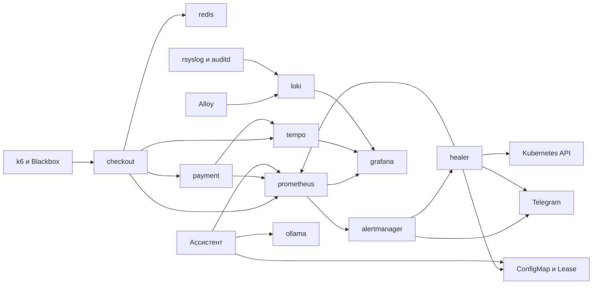

# Архитектура и стек. Кейс 2, SRE-платформа наблюдаемости

Учебный сервис `checkout` принимает `GET /work`, пишет корзину в Redis и вызывает `payment`. Платформа замечает, что запросы стали медленными или ошибочными, связывает метрику, трейс и лог одного запроса и восстанавливает сервис с проверяемыми ограничениями.

Диагноз и лечение выполняет `healer` по правилам и цифрам. Локальная языковая модель кластер не меняет: она объясняет текущие цифры или готовит черновик отчёта по уже закрытому инциденту.

Роли команды: [team.md](team.md). Соответствие пунктам задания: [requirements.md](requirements.md). Запуск и версии: [README](../README.md).

## Как идёт один запрос

1. Фон k6 непрерывно вызывает `GET /work` у checkout, около 3 запросов в секунду. Отдельный всплеск нагрузки запускается как Kubernetes Job `k6-spike`.
2. Checkout увеличивает номер корзины в Redis и вызывает `POST /pay` у payment.
3. Checkout и payment пишут JSON-лог в stdout и отправляют трейс в Tempo. У запроса один `trace_id` на оба сервиса.
4. Метрики приложений отдаются на отдельном порту 8081. Рабочие порты checkout, payment и Redis закрыты mTLS: сервисы принимают соединения только друг от друга. Подробности: [mtls.md](mtls.md).
5. Blackbox Exporter сам периодически вызывает рабочую цепочку и записывает, ответила ли она успешно. Это проверка «сайт жив сейчас», отдельно от статистики уже прошедших запросов.

Alloy читает stdout подов. Журналы самой машины Ubuntu в Loki попадают отдельно: [linux-logs.md](linux-logs.md).

## Как компоненты общаются

Отдельной базы приложения нет. Записи Kubernetes лежат в etcd кластера. Программы ходят друг к другу по HTTP и по API Kubernetes.

| Кто | Куда | Зачем |
|---|---|---|
| Prometheus | порт 8081 приложений и healer | забирает метрики каждые 15 секунд |
| Blackbox | `GET /work` | пробный заход пользователя |
| Alertmanager | `POST` на webhook healer | готовая тревога, не сырые метрики |
| healer | Prometheus | свежие цифры перед решением |
| healer | Kubernetes API | dry-run, затем удаление пода, scale, откат или рестарт Redis |
| healer | Telegram | вопрос с кнопкой и опрос ответа |
| Grafana | Prometheus, Loki, Tempo | экраны, без записи состояния |
| ассистент | Prometheus, ConfigMap, Ollama | текст отчёта, без команд в кластер |

## Как обнаруживается и лечится поломка

1. Правило Prometheus смотрит последнюю минуту. Если доля ошибок `GET /work` выше 0,5% или p95 медленнее 300 мс и это держится 30 секунд, появляется тревога.
2. Alertmanager отправляет её healer. При настроенном Telegram то же уведомление уходит в чат.
3. Healer собирает один снимок: ошибки, задержка по подам, загрузка CPU, результат Blackbox, текущие поды checkout. Снимок принимается, только если цифры из namespace `demo`, поды принадлежат текущей версии checkout и точки свежие.
4. Правила в `healer/rules.yaml` выбирают одно действие. Безопасное healer выполняет сам после dry-run: Kubernetes сначала проверяет команду, не применяя её. Опасное уходит в Telegram и выполняется после кнопки разрешённого оператора. Как устроена кнопка: [telegram.md](telegram.md).
5. Каждые 5 секунд healer проверяет, вернулись ли хорошие цифры. Инцидент закрывается, когда запросы снова успешные и быстрые, пробный заход Blackbox свежий и успешный, а нужная версия Deployment поднята. Время от внесения поломки до этого момента — MTTR. Момент «Kubernetes принял команду» финишем не считается.

| Что видно по цифрам | Действие | Кто решает |
|---|---|---|
| Один под минимум втрое медленнее остальных, CPU при этом не упёрт в лимит | Удалить этот под | Healer сам, после dry-run |
| Все поды медленные и упёрлись в лимит CPU | Поднять checkout с 2 до 5 реплик | Healer сам, после dry-run |
| Свежий релиз и ошибки самого приложения | Откатить checkout | Кнопка в Telegram |
| Redis жив, но checkout до него не достучался | Перезапустить Redis | Кнопка в Telegram: корзина хранится в памяти и сотрётся |
| Payment жив, но вызовы до него обрываются по таймауту | Ничего не менять | Только человек: перезапуск сеть не откроет |
| Нет метрик, неизвестная причина или ошибка самого payment | Ничего не менять | Только человек |

За один инцидент разрешено не больше двух изменений кластера. После действия пауза 120 секунд. Кнопка Telegram действует 5 минут и только для того запроса, к которому её отправили. Вернуть checkout с 5 реплик на 2 healer может только если пятёрку поставил он сам и всплеск k6 уже закончился.

Пустые или устаревшие метрики не считаются здоровьем. Пока цифр нет, healer не закрывает инцидент и не уменьшает число реплик.

Что смотреть дежурному: [CheckoutSlow](runbooks/checkout-slow.md), [CheckoutHighErrorRate](runbooks/checkout-high-error-rate.md), [синтетика](runbooks/checkout-synthetic.md), [связка метрика-трейс-лог](runbooks/incident-chain.md), [бюджет SLO](runbooks/slo-budget.md), [отказ самого healer](runbooks/healer.md).

## Где что хранится

| Что | Где | Кто пишет и кто читает |
|---|---|---|
| Текущий инцидент, журнал команд и событий | Один ConfigMap `heal/healer-state`, поле `state.json` | Пишет и читает healer. Ассистент только читает |
| Право лечить, одна активная копия healer | Lease `heal/healer-leader` | Берёт и обновляет healer |
| Число реплик и версии сервисов | Deployment в Kubernetes | Меняет healer в пределах своих прав |
| Корзина | Память Redis, без записи на диск | Пишет checkout |
| Метрики | Диск Prometheus | Пишут приложения и Blackbox, читают Prometheus, healer, Grafana, ассистент |
| Логи подов и журналы Ubuntu | Loki | Собирает Alloy, читает Grafana |
| Трейсы | Tempo | Пишут checkout и payment, читает Grafana |
| Секреты Telegram, webhook и пароль Grafana | Secret Kubernetes | В git не попадают |
| Ответ языковой модели | Только HTTP-ответ запросившему | В ConfigMap и в Loki не сохраняется |
| Файлы модели | Диск тома `ollama-models` | Читает Ollama |

ConfigMap состояния один на весь healer. Вторая одновременная поломка не создаёт второй объект: пока инцидент открыт, новые цифры относятся к нему. Подробности ассистента: [llm.md](llm.md).

Права healer записаны в `k8s/healer.yaml` и применяются при установке. Ему разрешено менять Deployment `checkout` и `redis`, удалять поды в `demo` и читать Job всплеска. Читать секреты и свободно менять payment нельзя.

## Namespace

| Namespace | Что внутри |
|---|---|
| `demo` | checkout, payment, Redis, k6. Между рабочими портами включён STRICT mTLS |
| `obs` | Prometheus, Alertmanager, Grafana, Blackbox, Loki, Alloy, Tempo |
| `heal` | healer и ассистент отчётов |
| `istio-system` | Istio |
| `chaos-mesh` | Chaos Mesh, сценарии намеренных поломок |
| `assist` | Ollama, необязательный компонент |

Образы приложений помечаются по содержимому и сверяются с исходниками до выката: [local-images.md](local-images.md).

## Стек

| Слой | Технология |
|---|---|
| Приложения | Python, FastAPI, HTTP-клиент, Redis, OpenTelemetry |
| Метрики | Prometheus, kube-prometheus-stack 91.9.0, Blackbox Exporter |
| Тревоги | Alertmanager, webhook healer |
| Логи | Grafana Alloy v1.20.0, Loki, rsyslog и auditd на Ubuntu |
| Трейсы | Tempo, exemplars Prometheus с `trace_id` |
| Экраны | Grafana |
| Кластер | k3d, k3s v1.35.5-k3s1, один узел |
| Сеть сервисов | Istio 1.30.5, STRICT mTLS на рабочих портах |
| Намеренные поломки | Chaos Mesh 2.8.4 |
| Нагрузка | k6 |
| Автолечение | healer на Python, правила в `healer/rules.yaml`, dry-run Kubernetes API |
| Подтверждение опасных действий | Telegram Bot API, список разрешённых операторов |
| Отчёт | Отдельный ассистент, Ollama 0.35.1, модель Qwen2.5 1.5B, только чтение |
| Установка | make, Helm, Ansible, GitHub Actions на чистом Ubuntu |

Кластер поднимается локально: на macOS через Colima командой `make up`, на Ubuntu командой `make up-linux`. Языковая модель ставится отдельно командой `make llm` и для лечения не нужна.

## Цели по запросу `GET /work`

| Показатель | Цель |
|---|---|
| Успешные ответы | Не меньше 99,5% за последнюю минуту |
| Скорость | p95 быстрее 300 мс |
| Рабочая цепочка | Blackbox получает HTTP 200, `status=ok` и успешный payment |

Отдельно считается бюджет этих целей на 30 дней. На стенде нет месяца непрерывной истории, поэтому выполнение месячной цели не заявляется.

## Что измерено

На чистом Ubuntu одна и та же поломка медленного пода: без автоматики 135,0 с, с healer 121,8 с. Это один прогон, не статистика. Нагрузка 11 запросов в секунду на том же стенде: две реплики уже не укладывались в 300 мс, пять укладывались. Healer вернул скорость за 147,8 с, пока нагрузка ещё шла, и сам вернул две реплики.

Видео 4:12 снято отдельно, на локальном стенде с двумя CPU и профилем 16 запросов в секунду: [demo.md](demo.md). Его цифры не подменяют прогон CI.

Короткий хаос не доказывает живучесть при полном обрыве сети. Модель не ищет причину свободно и не заменяет правила.
