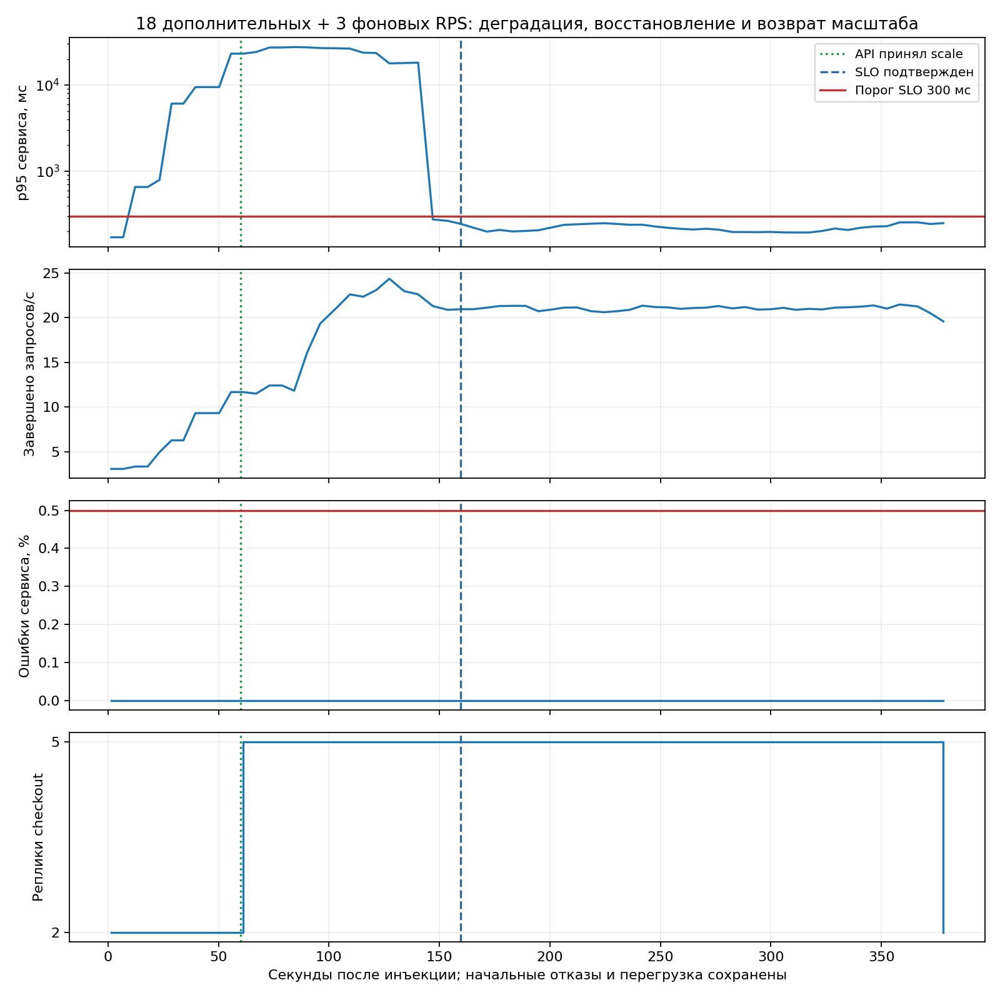
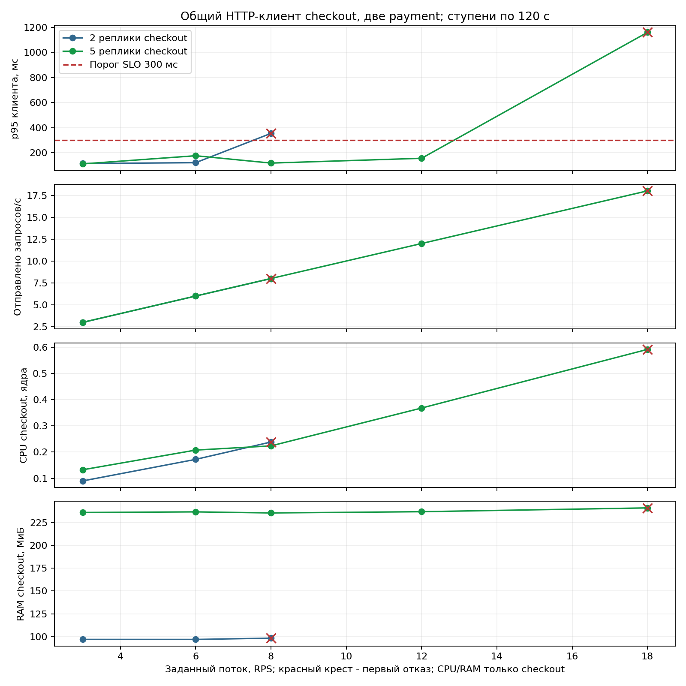
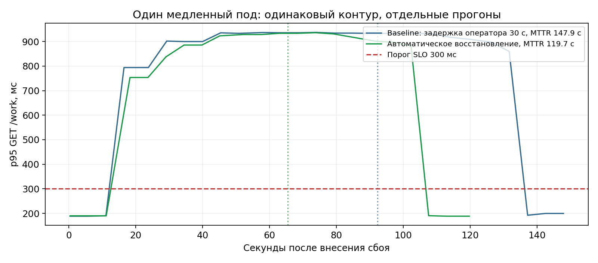
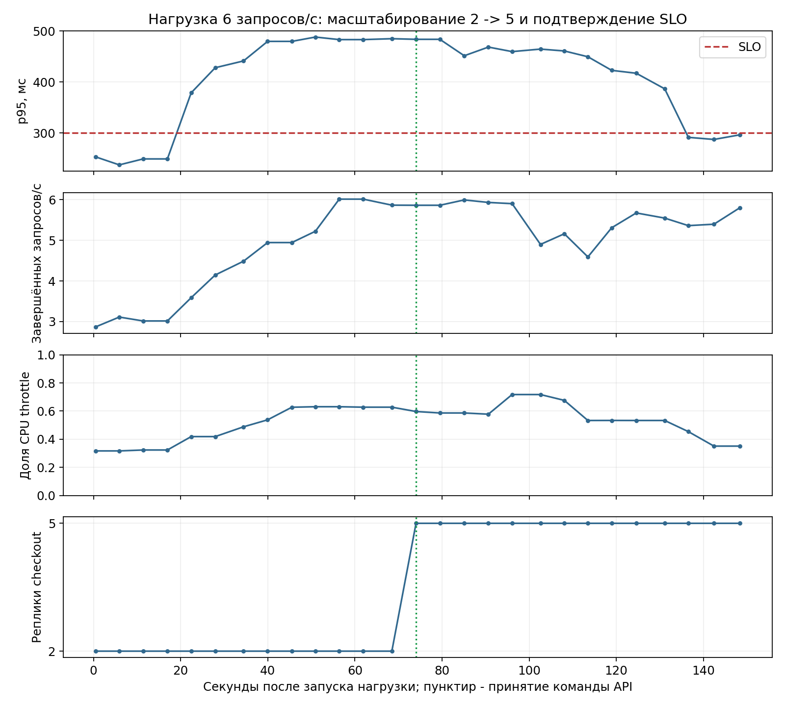
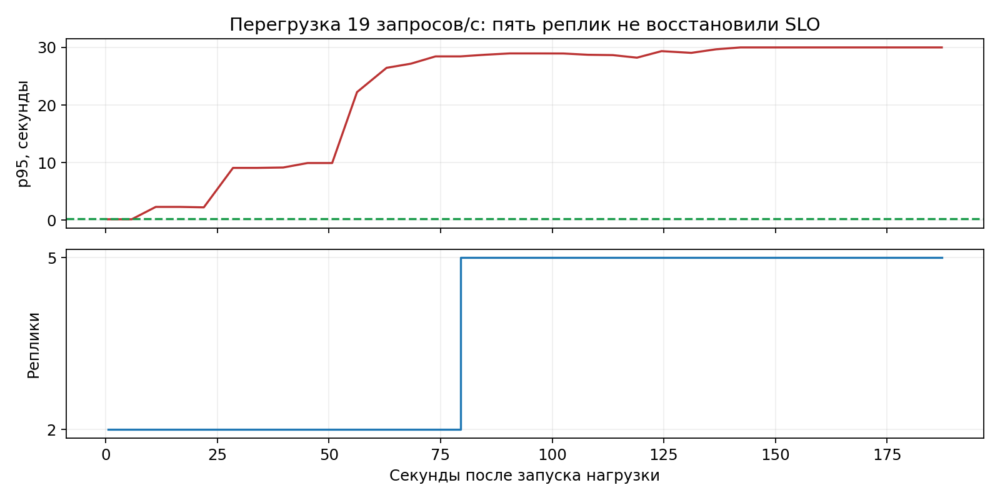
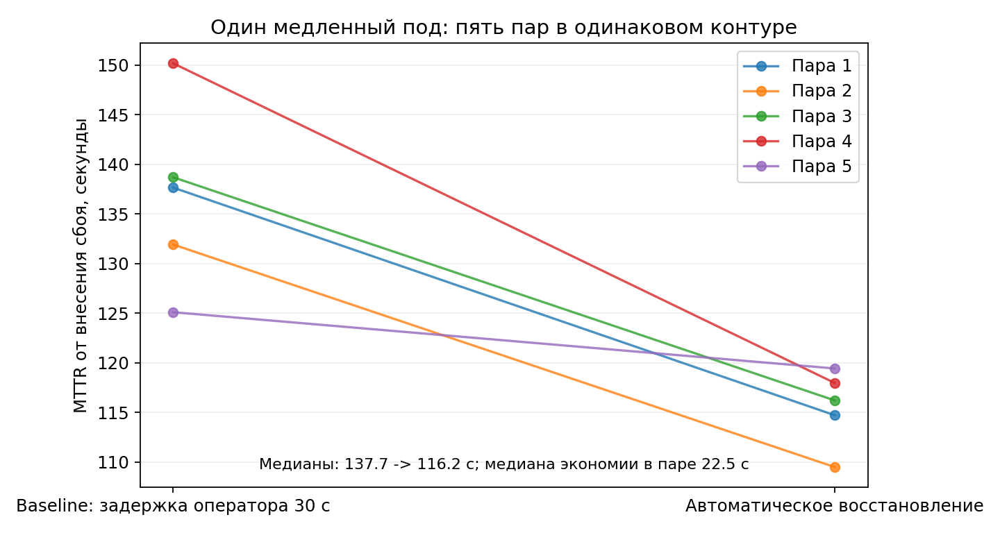
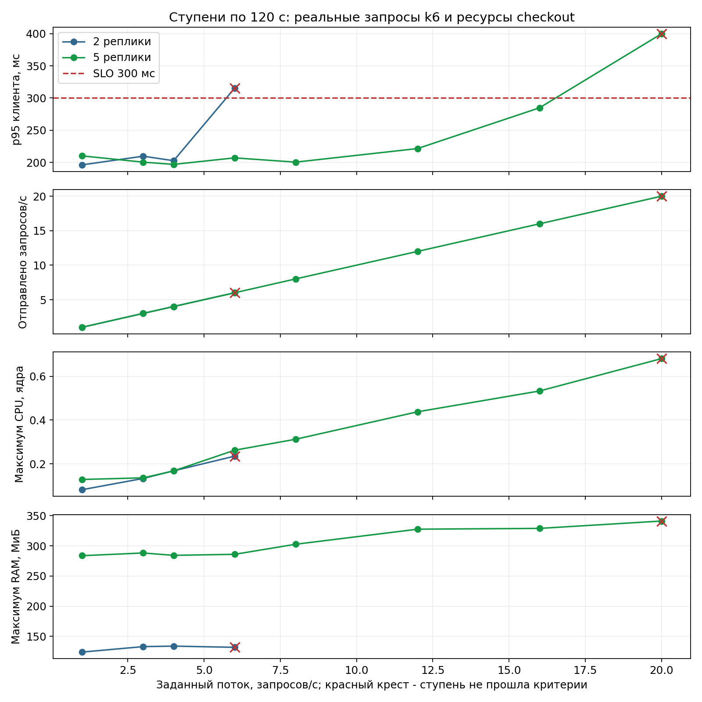

# Эксперименты и происхождение измерений

## Текущая калибровка CPU и подтверждение образов

Ветка включает исправления контракта payment и рабочих образов. [Сверка всех реплик](results/iteration-4/branch-runtime-images.json) и [повтор без rollout](results/iteration-4/branch-image-noop-comparison.json) сохранены; healer после исправления позднего resolved проверен [отдельно](results/iteration-4/orphan-healer-runtime.json). Эти хеши не приписываются историческим опытам.

Для проверки переносимости CPU-демо собственный k3d-контейнер временно ограничен двумя CPU из 22 доступных хосту. Это сохраняет локальный процессор, память, диск и сеть; тождество GitHub runner не заявляется. [Первая серия](results/iteration-2/capacity-two-cpu.json) прошла 6, 9 и 12 RPS при двух и пяти репликах, но не установила границу отказа. Ее оболочка [не подтвердила возврат CPU](results/iteration-2/capacity-two-cpu-environment.json): пустое исходное CpusetCpus не восстановилось командой Docker. Затем [отдельно восстановлены все 22 CPU](results/iteration-2/capacity-cpu-restored.json) явным списком. Эффективный доступ восстановлен, исходная пустая строка не объявляется восстановленной побайтно.

[Серия e283970](results/iteration-4/current-cpu-capacity.json) прошла 9 и 12 RPS при двух репликах, не прошла 15; пять прошли 9, 12, 15, 18 и 24. CPU [возвращены к тому же явному списку](results/iteration-4/capacity-two-cpu-environment.json). Последние окна 15 RPS приблизились к SLO, поэтому выбор устойчивого CPU-профиля потребовал продолжения ступеней и проверки действующего Job.

[Калибровка 3e1df76](results/iteration-4/cpu-profile-capacity.json) прошла 12 RPS при двух репликах, не прошла 18: клиентский p95 2543.4 мс, 1613 отправленных запросов и 8 пропусков. Пять реплик прошли 12 и 18, p95 при 18 - 133.9 мс, 1621 запрос, пропусков нет. [Очистка и CPU подтверждены](results/iteration-4/cpu-profile-capacity-environment.json). Строгий выбор профиля отклонил ступень с пропусками клиента; положительный CPU-опыт из нее не выдумывается.

[Промежуточная серия 12 и 16 RPS](results/iteration-4/cpu-profile-capacity-16.json) той же версии завершена. При 16 клиентский p95 двух реплик 941.3 мс, пяти 115.1 мс; пропусков и HTTP-ошибок нет. Три последних окна действующего Job подтвердили устойчивую деградацию двух и здоровье пяти при том же потоке. [Ограничение CPU возвращено](results/iteration-4/cpu-profile-capacity-16-environment.json). Этот замер допускает выбранную ступень и не устанавливает точный максимум. [График клиентских ступеней](results/iteration-4/cpu-profile-capacity.png).

[Полный CPU-опыт](results/iteration-4/cpu-profile-spike.json) использовал выбранные 16 RPS, тот же контур, версию и два CPU; фон защищенно выключен. Детект 19.4 с, принятие API 56.8 с, три здоровых внешних окна 88.2 с. Внутренняя отметка healer сохранена отдельно. Восстановление достигнуто при продолжающемся Job. Естественное окончание и самостоятельный возврат двух реплик подтверждены до очистки, через 225.5 с от инъекции. Все 3361 HTTP-ответа успешны, пропусков нет; клиентский p95 за весь опыт 266.3 мс. Начальный минутный серверный SLO нарушен, его история сохранена на [графике восстановления](results/iteration-4/cpu-profile-recovery.png). [Среда возвращена](results/iteration-4/cpu-profile-spike-environment.json). [Видео](demo.md) отдельно описывает дискретную запись и обозначенную склейку ожидания.

[Повтор NoData](results/iteration-4/nodata-current.json) на скрипте 152ea6a прошел: новых операций нет, ServiceMonitor сохраняет UID, сбор и алерт восстановлены. Завершение подтверждено сохраненным закрытым состоянием, несмотря на поздний ответ webhook `ignored: no active incident`. [Отрицательный полный CI 3e1df76](results/iteration-4/ci-nodata/run.json) сохранен и не заменяется локальным успехом. Новый полный CI cf65858 проверяется отдельно.

## Измерения предыдущих версий

## Новые измерения 7 октября после повторного использования HTTP-клиента

Checkout использует один клиент payment на срок процесса. [Отдельный сетевой повтор](results/iteration-2/limited-client-reuse-network.json) подтвердил настоящий разрыв одного пути, рабочий резерв, алерт и 360 полных ответов без ошибок: клиентский p95 102.2 мс, максимум серверного p95 98.6 мс. [Полная серия чистого Ubuntu CI на d09338c](results/iteration-2/ci-scenarios/limited-chaos.json) прошла ограниченные отказы пода, сети и CPU; клиентские p95 составили 70.7/77.0/118.4 мс, максимальные серверные - 86.3/113.3/166.8 мс. Остальные этапы этого CI, включая неуспешную проверку состояния, описаны в [аудите](audit.md).

[Полный CPU-опыт](results/iteration-2/spike-client-reuse.json) задал 18 дополнительных и три фоновых RPS на 360 секунд. Healer применил scale через 59.9 с, внешний MTTR составил 159.5 с. Job завершился естественно; возврат к двум репликам самим healer подтвержден через 378.1 с до очистки CLI. Начальная перегрузка сохранена: 697 отказов из 6310 клиентских запросов, 170 dropped iterations, p95 клиента за весь прогон около 10 секунд. Восстановление во время нагрузки не означает непрерывное удержание SLO.



[Новая серия мощности](results/iteration-2/capacity-client-reuse.json) завершила восемь ступеней по 120 секунд с отключенными healer и фоновым клиентом. Для двух реплик прошли 6 RPS, первая проверенная неуспешная ступень - 8 RPS с клиентским p95 353.5 мс. Для пяти прошли 12 RPS, не прошли 18 с p95 1161.2 мс. Все плановые итерации отправлены, dropped iterations отсутствуют. Это интервалы между проверенными ступенями, не точный максимальный RPS. Пиковые ресурсы checkout на прошедших верхних ступенях: 0.172 ядра/96.8 МиБ для двух реплик, 0.368 ядра/237.2 МиБ для пяти; Istio и остальной стек в эту сумму не входят.



Разные длительности и критерии ступеней мощности и CPU-демо не дают основания объявить 18-21 RPS непрерывно допустимой нагрузкой. Графики воспроизводятся командой `python docs/results/iteration-2/plot-current.py`, исходные JSON сохраняются.

[Сверка локального контура](results/iteration-2/current-runtime.json) подтверждает checkout и healer по 24c22ec, но выявляет один прежний образ payment. [Сравнение исходника и AST](results/iteration-2/payment-runtime-difference.json) ограничило различие двумя описаниями HELP метрик; пути запросов, имена, метки и границы гистограммы совпадают. Первоначальный отрицательный результат сохранен. Для чистого CI происхождение образов проверяется отдельно; локальные измерения не объявляются побайтово однородными.

## Историческая среда 6 октября

Контур: отдельный k3d mtc-review, k3s 1.35.5-k3s1, Docker Engine 27.5.1 в Ubuntu WSL. У checkout две исходные реплики, лимит CPU каждой - 200m, CPU_ITERS=40000. Включены Istio STRICT mTLS, фон k6 3 запроса/с, Blackbox и Alloy. Локальная модель во время сравнения не генерировала ответы.

## Методика

Исторические серии ниже сохраняют исходную методику и топологию. Начиная с b58f406, `scripts/experiment.py` также ждет закрытого инцидента в ConfigMap до подготовки и перед инъекцией. Активное подтверждение, восстановление, неопределенная операция или неочищенный таймер блокируют новый опыт. [Изолированный прогон](results/iteration-2/incident-isolation.json) дал внешний MTTR 117.3 с и внутренний 51.9 с, с новым началом healer после инъекции. Эти времена относятся к одному прогону и не заменяют объединенные 249.2 с старого postmortem.

`scripts/experiment.py` ждет здорового SLO и отсутствия всех активных алертов. Между автоматическими прогонами healer пересоздается; состояние незавершенного инцидента сохраняется в ConfigMap и запрещает следующий опыт. Режим baseline отключает healer и через 30 секунд после firing выполняет ту же команду, что автомат. Эта задержка задается экспериментом и не доказывает среднюю скорость дежурного.

Новые испытания удержания SLO описаны в [отдельной области хаоса](runbooks/chaos-limited.md). В рабочем манифесте теперь две реплики payment и резервный маршрут Istio; в этом испытании checkout временно увеличивается с двух до трех. Ранние графики мощности и MTTR относятся к сохраненной топологии и ресурсам своей серии, а не объявляются замером новой конфигурации.

Начало внешнего MTTR - внесение сбоя. Конец - три последовательных здоровых измерения с интервалом около 5 секунд: p95 < 300 мс, 5xx <= 0.5%, поток запросов > 0, свежая синтетика и готовый Deployment. Принятие команды API и внутреннее подтверждение healer сохраняются отдельными полями. По окончании скрипт снимает внесённый эксперимент и возвращает исходные реплики.

Встроенный таймер healer начинается с startsAt алерта. Поэтому он короче внешнего MTTR от внесения сбоя. Удаление пода или запись scale в Kubernetes сами по себе не завершают ни один из таймеров восстановления.

## Один медленный под

В исторических прогонах задержка 500 мс применялась к исходящему трафику одного checkout в сторону payment. В обоих прогонах действие - удалить выбранный под; Deployment создаёт замену. После введения connectTimeout 100 мс эта инъекция вызывает отказ зависимости, что сохранено в [новом воспроизведении](results/iteration-2/state-diagnostics-local.json). Текущий slow-pod задерживает обращения одного checkout к Redis на 250 мс; [проверка состояния](results/iteration-2/state-isolated-delay.json) прошла. Прежние MTTR не присваиваются измененному сценарию.

| Режим | Детект, с | Команда API, с | Подтверждённое восстановление, с |
|---|---:|---:|---:|
| Baseline | 16.5 | 92.3 | 147.9 |
| Автоматический | 18.3 | 65.5 | 119.7 |

В этом парном сравнении восстановление быстрее на 28.2 с, или примерно 19%. Один прогон не оценивает статистическую среднюю и не обещает такой выигрыш на другом оборудовании. Данные: [baseline](results/slow-pod-baseline.json), [автоматический](results/slow-pod-auto.json).



Первое сравнение также сохранено: [baseline 151.6 с](results/slow-pod-baseline-initial.json), [автоматический 164.8 с](results/slow-pod-auto-initial.json). В нём предыдущие алерты не были полностью погашены, а во время автоматического прогона импортировался крупный образ. Эта пара не используется как корректное сравнение. После неё добавлены ожидание всех алертов, игнорирование запоздавшего firing при здоровом SLO, перезапуск healer и интервалы evaluation/group_interval 15 секунд.

## Нагрузка CPU и масштабирование

Суммарно задано 6 запросов/с: три фоновых и три дополнительных. На двух репликах p95 поднялся примерно до 490 мс, CPU throttle превысил порог 0.4. Healer применил scale до пяти реплик через 74.0 с. Три здоровых измерения получены через 148.4 с при ещё работающей дополнительной нагрузке. Затем скрипт завершил k6 и вернул исходные две реплики.

Клиент k6 дополнительно выполнил 426 запросов, проверка HTTP 200 прошла во всех 426 случаях. Его p95 за весь прогон - 492.4 мс; это включает период нарушения SLO и отличается от здорового минутного окна в конце. Результат: [spike-auto.json](results/spike-auto.json).



Исходные 19 запросов/с оказались перегрузкой для этого стенда. Healer увеличил число реплик до пяти, но p95 и синтетика не восстановились. Через примерно 188 секунд прогон остановлен, нагрузка снята, результат [spike-overload.json](results/spike-overload.json) отмечен как неуспешный. Эти данные определяют наблюдаемый предел конкретного окружения; точная максимальная мощность отдельным поиском по всем уровням нагрузки не измерялась. Шкала гистограммы ограничивает точность больших p95.



Поэтому стандартная дополнительная нагрузка снижена с 16 до 3 запросов/с. RATE и DURATION в k6 позволяют задать другой профиль. Важно проверять и клиентский итог, и синтетику: только счётчики завершённых запросов сервера не показывают все клиентские таймауты.

## Дополнительные проверки

`scripts/verify-scenarios.py` проверил все четыре случая на реальном контуре: замену пода Kubernetes без действия healer, отказ от вмешательства при сетевом разрыве и отсутствие опасного отката/рестарта без Telegram. Результат: [scenarios.json](results/scenarios.json). Во время проверки отказов зависимости рабочие поды сохранились. Затем в отдельном тестовом боте проверены настоящий откат по кнопке и отказ от рестарта: [telegram-approve.json](results/iteration-1/telegram-approve.json), [telegram-reject.json](results/iteration-1/telegram-reject.json). Управляемые тесты покрывают срок, чат, оператора, устаревший ID, изменение ревизии и ошибку применения.

Первый дополнительный прогон [scenarios-initial.json](results/scenarios-initial.json) прошёл kill и partition, но остановился на проверке идентичности подов релиза: скрипт включал завершающиеся поды прежней ревизии. Фильтр исправлен, повторный прогон прошёл все четыре случая. Эта ошибка проверочного скрипта не считается действием healer.

Переменная CLUSTER должна совпадать с контекстом k3d. Скрипты не используются на рабочем кластере. Графики пересоздаются из исходных JSON:

```sh
pip install -r scripts/requirements-report.txt
python scripts/plot-results.py
```

## Повторная серия 7 октября по московскому времени

Пять пар прошли без пропусков: медиана baseline 137.7 с, автоматики 116.2 с; минимумы и максимумы 125.1-150.2 с и 109.5-119.4 с. Медиана экономии внутри пары - 22.5 с, разброс 5.7-32.2 с. Это не p95 MTTR и не промышленный норматив. Все десять исходных прогонов, случайный порядок внутри пары и параметры среды сохранены в [summary.json](results/iteration-1/repeated-mttr/summary.json).



Серия выполнялась с неизменным образом healer; опись demo собрана до начала, отдельная проверка тега healer - после серии, что отмечено явно. Локальная модель не генерировала ответы. Во время серии также запускался promtool, поэтому полная изоляция аппаратных ресурсов не заявляется.

Повторить в новом каталоге: `python scripts/benchmark.py --pairs 5 --output-dir docs/results/repeated-mttr`. График: `python scripts/plot-results.py --iteration-dir docs/results/iteration-1`. Ступени мощности выполняются отдельным `capacity.py` с отключенными фоновым клиентом и healer; результаты этого испытания рассматриваются отдельно от MTTR.

## Ступени мощности и ресурсы

Каждая ступень длилась 120 секунд при фиксированном числе реплик; между ступенями оставлено время на завершение запросов. Фоновый клиент и healer отключены на время серии, после нее восстановлены. Клиентские итоги k6 проверяются отдельно от серверного минутного окна: не менее 99% запланированных итераций отправлены, нет dropped iterations, доля HTTP-ошибок не выше 0.5%, p95 клиента ниже 300 мс. Дополнительно нужны три здоровые выборки в конце и готовый Deployment.

| Реплики | Задано RPS | p95 клиента, мс | Отправлено / план | Максимум CPU, ядра | Максимум RAM, МиБ | Критерии пройдены |
|---|---:|---:|---:|---:|---:|---|
| 2 | 1 | 196.3 | 120 / 120 | 0.081 | 123.9 | Да |
| 2 | 3 | 209.7 | 361 / 360 | 0.133 | 132.9 | Да |
| 2 | 4 | 202.7 | 481 / 480 | 0.168 | 133.8 | Да |
| 2 | 6 | 315.3 | 720 / 720 | 0.235 | 131.8 | Нет |
| 5 | 1 | 210.2 | 120 / 120 | 0.128 | 283.7 | Да |
| 5 | 3 | 200.4 | 361 / 360 | 0.136 | 288.1 | Да |
| 5 | 4 | 197.0 | 481 / 480 | 0.167 | 284.2 | Да |
| 5 | 6 | 207.1 | 720 / 720 | 0.262 | 285.9 | Да |
| 5 | 8 | 200.5 | 961 / 960 | 0.312 | 302.6 | Да |
| 5 | 12 | 221.6 | 1440 / 1440 | 0.438 | 327.6 | Да |
| 5 | 16 | 284.8 | 1920 / 1920 | 0.533 | 328.9 | Да |
| 5 | 20 | 399.8 | 2400 / 2400 | 0.681 | 341.1 | Нет |

HTTP-ошибок и dropped iterations в этих ступенях нет; две последние не прошедшие ступени нарушили задержку. CPU и RAM - сумма измеренного потребления контейнеров checkout, без Istio и остальных компонентов кластера; это не минимальная аппаратная конфигурация. Лимит каждой реплики checkout - 200m CPU и 256Mi RAM, запрос ресурсов - 50m и 64Mi.

Данные основной серии: [capacity.json](results/iteration-1/capacity.json); дополнительный поиск границы для пяти реплик: [capacity-upper.json](results/iteration-1/capacity-upper.json). Наблюдаемые интервалы проходят от 4 до 6 RPS для двух реплик и от 16 до 20 RPS для пяти. Точный максимум внутри интервала, повторяемость на другом оборудовании и длительная устойчивость не установлены. Первую попытку дополнительной серии прервал недоступный port-forward Prometheus после обновления его PVC; [неуспешный результат](results/iteration-1/capacity-upper-initial.json) сохранен и исключен из графика. Дополнительная серия запущена после обновления Prometheus и восстановления доступа; полная одинаковость его предшествующей истории не заявляется.



Повторить: `python scripts/capacity.py --cluster mtc --rates 1,3,4,6,8,12,16,20 --duration 120 --output docs/results/new-capacity.json`. Скрипт прекращает повышение после первой не прошедшей ступени для каждого числа реплик. Дополнительную серию для пяти реплик можно выполнить с `--replicas 5`; результаты обоих запусков сохранять раздельно.
